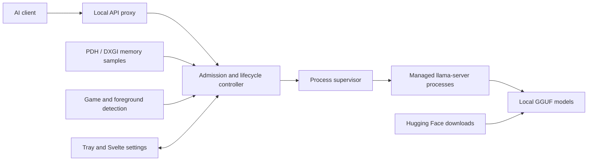
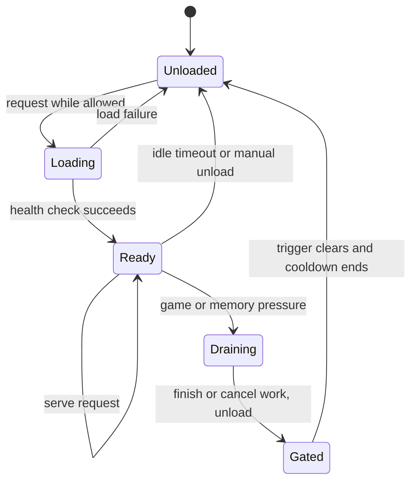

# VRAM Gatekeeper

**GPU-memory coordination for local LLMs and games on Windows.**

VRAM Gatekeeper is a background application that sits between AI clients and [llama.cpp](https://github.com/ggml-org/llama.cpp). It coordinates model loading, request admission, and GPU-memory pressure. When a configured game starts or VRAM runs short, it drains in-flight requests, unloads the managed models, and reloads them on demand once the condition clears.

**Status: experimental alpha (v0.1.0).** A Windows installer is available as a pre-release on the [Releases page](../../releases). It has not yet been verified on a clean machine, and hardware and game compatibility are still under validation. VRAM Gatekeeper is an independent project and is not affiliated with llama.cpp, NVIDIA, or any game platform.

[Install](#install) · [Features](#features) · [Architecture](#architecture) · [Build from source](#build-from-source) · [Validation](#validation-status) · [Contributors](#contributors) · [License](#license)

## Install

Requires Windows 10 (22H2) or Windows 11, x64.

1. Download `VRAM Gatekeeper_<version>_x64-setup.exe` from the [latest release](../../releases/latest) and compare its SHA-256 with the value in the release notes. The file is about 534 MiB because it bundles two llama.cpp engines (CUDA and Vulkan).
2. Run the installer. It installs for the current user only and needs no administrator rights, no Visual C++ redistributable, and no separate llama.cpp download. WebView2 is installed if Windows does not already have it.
3. Start **VRAM Gatekeeper**. It runs in the system tray; open the settings window from the tray icon. A discrete NVIDIA GPU uses the CUDA engine, and other GPUs use the Vulkan engine.

Point your client's OpenAI-style base URL at `http://127.0.0.1:8088/v1`; Anthropic-style requests use `/v1/messages`. The port is configurable, and the Status page shows the exact URLs and the model name to enter for each model.

## Purpose

A local LLM and a game compete for dedicated GPU memory, and closing the chat window does not necessarily unload the model. VRAM Gatekeeper provides one place to manage model lifetime, explains why inference is unavailable, and restores service afterward. It manages its own `llama-server` child processes. It cannot free memory allocated by unrelated programs, and it does not manage other LLM applications.

## Features

- Local proxy for OpenAI-style and Anthropic-style llama.cpp requests, with streaming and cancellation.
- Per-model supervision, on-demand loading, idle unloading, and configurable request-drain policies.
- Windows PDH and DXGI memory monitoring, pressure thresholds, and game and foreground-window detection.
- Tray host with a Svelte settings window that exists only while it is open.
- Hugging Face search, resumable checksum-verified downloads, and a local model library.
- The full `llama-server` parameter set per model, generated from `llama-server --help` and shown with readable names.
- Speculative decoding per model: separate draft model, EAGLE-3, DFlash, DSpark, Multi-Token Prediction, and n-gram types.
- CUDA and Vulkan engine selection, and official llama.cpp engine updates with SHA-256 verification and rollback to the bundled engine.
- Per-user NSIS installer that bundles both engines.

Hardware acceptance coverage is tracked in the [manual test matrix](docs/testing/manual-test-matrix.md).

## Architecture



The gate decides whether a request may proceed. The supervisor owns the engine processes, and the proxy tracks in-flight work so that unloading follows the selected drain policy.



The diagram omits error recovery, manual holds, and per-model policies. See the [design specification](docs/spec.md) and the [architecture decision records](docs/adr/).

## Build from source

Prerequisites: a Windows x64 machine with a working GPU driver, Rust stable (MSVC target), Visual Studio C++ Build Tools with the Windows SDK, Node.js, PowerShell 7, and WebView2. Backend compatibility depends on the selected upstream llama.cpp build. A local checkout is recommended; Windows will not run freshly built programs from a network drive.

From the repository root:

```powershell
pwsh tools/ui.ps1 install
pwsh tools/fetch-engine.ps1
pwsh tools/ui.ps1 build
$env:GATEKEEPER_BUNDLED_ENGINES = Join-Path $PWD 'app/src-tauri/resources/engine'
cargo run --locked -p vram-gatekeeper
```

The fetch script downloads the pinned upstream assets listed in [engine-rules.json](tools/engine-rules.json); the CUDA assets are large. The repository contains no engines, model weights, or installers; installers are attached to GitHub releases. Review the third-party terms before redistributing a bundle.

To develop alongside an existing installation, isolate the settings and data folders:

```powershell
$env:GATEKEEPER_CONFIG_DIR = Join-Path $PWD '.local-config'
$env:GATEKEEPER_DATA_DIR = Join-Path $PWD '.local-data'
cargo run --locked -p vram-gatekeeper
```

Open the settings window from the tray, add a model, select a compatible engine, and configure the game and pressure behavior. A request may trigger a cold model load. The headless runner exposes the same core:

```powershell
cargo run --locked -p gatekeeper-cli -- --help
```

### Building the installer

```powershell
cargo install tauri-cli --version "^2" --locked   # once
pwsh tools/build.ps1
```

The script fetches any missing engines and writes the installer and a `manifest.json` to a new folder, `builds/<version>-build.<NNNN>/`. The `builds/` folder is git-ignored and earlier builds are kept. Set `CARGO_TARGET_DIR` to a folder on a local disk if the repository is on a network drive.

## Validation status

The checks that were rerun for the published source are recorded in [`docs/PUBLICATION_CHECKS.md`](docs/PUBLICATION_CHECKS.md). The project has been used daily on a single development setup, which is not a compatibility guarantee. [Phase 0 findings](docs/phase0-findings.md), [implementation status](docs/IMPLEMENTATION_STATUS.md), and the [manual test matrix](docs/testing/manual-test-matrix.md) distinguish recorded evidence from remaining work.

Unresolved acceptance cases:

- Real Steam, non-Steam, full-screen, and borderless games. Recorded detection used a renamed test process rather than a real game.
- Oversized models and real NVIDIA shared-memory fallback and pressure.
- AMD and Intel Vulkan hardware, multi-model contention, sleep and resume, and LAN use from a second machine.
- Installation and uninstallation on a clean account, and a full 24-hour soak.

Checks that do not load a model:

```powershell
cargo fmt --all --check
cargo test --locked -p gatekeeper-core --lib -- --skip gpu::windows_monitor::tests::adapter_counters_agree_with_nvidia_smi
cargo test --locked -p gatekeeper-core --test real_engine_fixtures
pwsh tools/ui.ps1 check
pwsh tools/ui.ps1 lint
```

Tests that use the real engine or the live network are opt-in and are skipped when their environment variables are not set, so check the test summary before treating a run as hardware validation. The CI workflow runs formatting, core and fixture tests, and the UI checks; it does not install the application, download models, run games, or exercise GPU hardware.

## Network and downloads

The proxy binds to loopback by default and rejects browser requests from origins that are not explicitly approved. LAN mode is optional; enable it deliberately and with authentication, as it has not been fully validated from a second machine. Keep private settings, tokens, diagnostic exports, and models out of version control.

The engine updater accepts only official llama.cpp release-download URLs, requires published SHA-256 digests, verifies every downloaded file, and rejects archive paths that escape the extraction folder. These safeguards are not a complete security audit. Hugging Face access and model licenses are separate matters.

## Repository layout

| Path | Purpose |
|---|---|
| `crates/gatekeeper-core` | Lifecycle, monitoring, proxy, downloads, and configuration |
| `crates/gatekeeper-cli` | Headless runner |
| `app/src-tauri` | Tauri v2 tray host, command bridge, and installer configuration |
| `app/ui` | Svelte 5 settings interface |
| `tools/fake-llama-server` | Process and proxy test double |
| `tools/` | Engine fetching, installer build, UI tooling, and icon generation |
| `docs/` | Design specification, decision records, status, and manual test matrix |

See also [`CHANGELOG.md`](CHANGELOG.md).

## Contributors

- **Ziqian (Kevin) Xu** ([@kisaed](https://github.com/kisaed)): author and maintainer.
- **Claude** ([Anthropic](https://www.anthropic.com/claude)): design, implementation, testing, and documentation.

Contributions that simplify the implementation, improve correctness, or reproduce real hardware and game behavior are welcome.

## License

The application source is released under the [MIT License](LICENSE). Dependencies, engines and runtimes, and downloaded models retain their own licenses; see the [third-party notices](app/src-tauri/resources/THIRD_PARTY_NOTICES.txt). The repository contains no engine or runtime binaries, but the release installer bundles llama.cpp (MIT), its libomp runtime, and the NVIDIA CUDA runtime libraries under the terms listed there.
