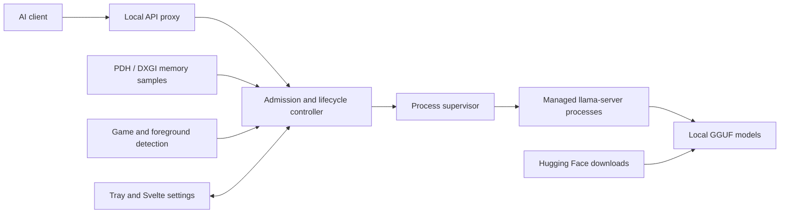
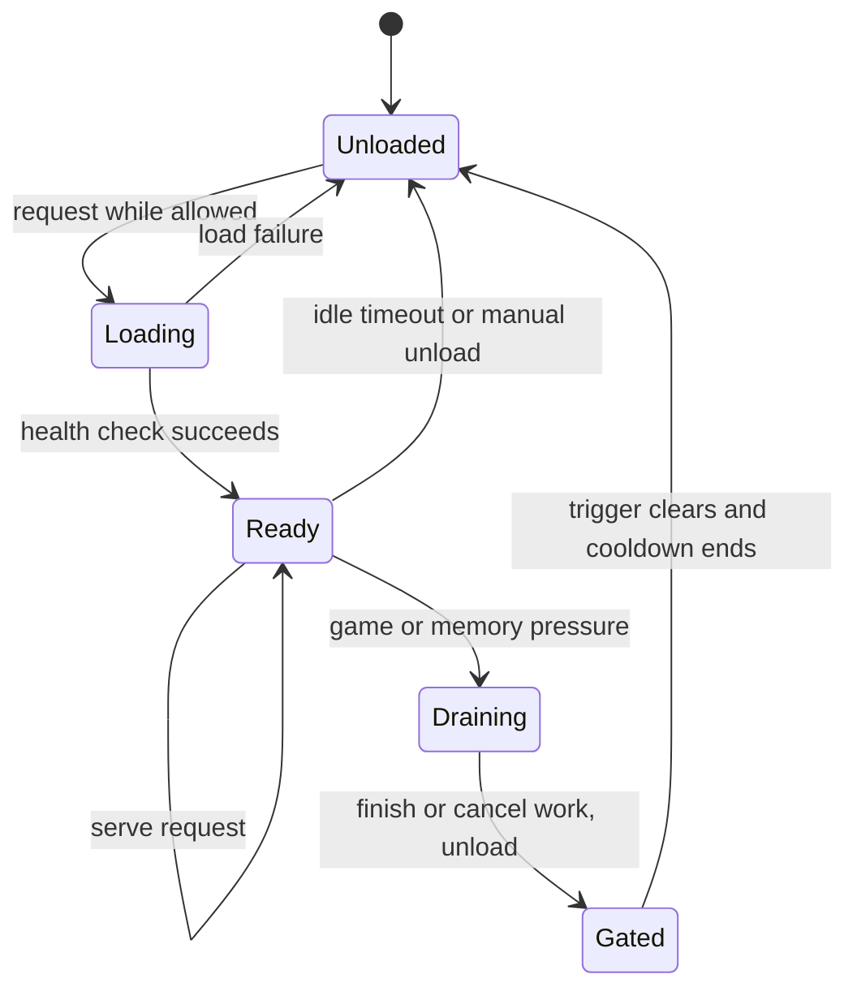

# VRAM Gatekeeper

**Give your game the GPU back without manually babysitting a local LLM server.**

A Windows background application between AI clients and [llama.cpp](https://github.com/ggml-org/llama.cpp). It coordinates model loading, request admission, and GPU-memory pressure. When a configured game or pressure condition closes the gate, it can drain requests and unload managed models, then reload on demand afterward.

**Experimental alpha; source distribution.** No installer release is included. Hardware/game compatibility remains under validation. This is an independent project, not an official llama.cpp, NVIDIA, or game-platform product.

## Why it exists

A local LLM and a game compete for dedicated GPU memory. Closing the chat window does not necessarily unload the model. Gatekeeper provides one place to manage model lifetime, explain why inference is unavailable, and restore service afterward. It manages its own `llama-server` child processes; it cannot promise to free memory allocated by unrelated programs or manage every LLM application.

## Features in the source

- Local proxy for supported OpenAI-style and Anthropic-style llama.cpp requests, including streaming/cancellation.
- Per-model supervision, on-demand loading, idle unloading, and configurable request-drain policies.
- Windows PDH/DXGI memory monitoring, pressure thresholds, and game/foreground detection.
- Tauri tray host with a Svelte settings window created when opened and destroyed when closed.
- Hugging Face browsing, resumable downloads, and a local model library.
- CUDA/Vulkan engine selection and official llama.cpp engine updates with checksum verification.
- Fake-server, fixture, property, unit, and opt-in real-engine tests.

Implementation does not imply every feature has passed real-hardware acceptance testing.

## AI assistance and ownership

Most implementation was generated with AI assistance. Kevin has used and manually tested the application daily and reports that it works on his current setup, but has not extensively reviewed the entire codebase. This project is shared for inspection, improvement, and testing. It is not presented as hand-written code or a comprehensively audited application.

Design/status documents and captured test output record development history; they are not a substitute for independently rerunning tests. Contributions that simplify the implementation, improve correctness, and reproduce real hardware/game behavior are especially welcome.

## Architecture



The gate decides whether a request may proceed. The supervisor owns engine processes; the proxy tracks in-flight work so unloading follows the selected drain policy.



This diagram simplifies error recovery, manual holds, and per-model policies. See the [design](docs/spec.md) and [architecture decisions](docs/adr/).

## Build and try it

A **local Windows x64 checkout** is simplest. Prerequisites: a working GPU driver, Rust stable/MSVC target, Visual Studio C++ Build Tools and Windows SDK, Node.js, PowerShell 7, and WebView2 for the desktop UI. Backend compatibility depends on the selected upstream llama.cpp build.

From the repository root:

```powershell
pwsh tools/ui.ps1 install
pwsh tools/fetch-engine.ps1
pwsh tools/ui.ps1 build
$env:GATEKEEPER_BUNDLED_ENGINES = Join-Path $PWD 'app/src-tauri/resources/engine'
cargo run --locked -p vram-gatekeeper
```

The fetch script downloads pinned upstream assets from [engine-rules.json](tools/engine-rules.json); CUDA assets can be large. This source tree contains no engines, model weights, or installers. Review third-party terms before redistributing a bundle.

For development alongside an existing installation, isolate local settings:

```powershell
$env:GATEKEEPER_CONFIG_DIR = Join-Path $PWD '.local-config'
$env:GATEKEEPER_DATA_DIR = Join-Path $PWD '.local-data'
cargo run --locked -p vram-gatekeeper
```

Open settings from the tray, add a model, select a compatible engine, and configure game/pressure behavior. Point a compatible client's OpenAI-style base URL at `http://127.0.0.1:8088/v1` and use the configured model ID. A request may trigger a cold model load. The headless runner exposes the same core:

```powershell
cargo run --locked -p gatekeeper-cli -- --help
```

Developers can package an NSIS installer with `cargo install tauri-cli --version "^2" --locked` followed by `pwsh tools/build.ps1`. That script fetches missing engines and creates a new numbered output under `builds/`. Packaging and clean-machine behavior require their own validation before a release; no prebuilt release is implied.

## Validation status

See the [dated public-source check results](docs/PUBLICATION_CHECKS.md) for the checks actually rerun on this publication copy.

Daily use is one setup's experience, not a compatibility guarantee. [Historical findings](docs/phase0-findings.md), [implementation tracking](docs/IMPLEMENTATION_STATUS.md), and the [manual matrix](docs/testing/manual-test-matrix.md) distinguish prior evidence from remaining work. Unresolved acceptance cases include:

- Real Steam/non-Steam, full-screen, and borderless games. Recorded detection used a renamed test process rather than a real game.
- Oversized models and real NVIDIA shared-memory fallback/pressure.
- AMD/Intel Vulkan hardware, multi-model contention, sleep/resume, and second-machine LAN behavior.
- Clean-account installation/uninstallation and the full 24-hour soak.

Real-engine/live-network tests are opt-in and may skip without their environment variables. A green command alone does not prove those scenarios ran.

Checks that do not load a model:

```powershell
cargo fmt --all --check
cargo test --locked -p gatekeeper-core --lib -- --skip gpu::windows_monitor::tests::adapter_counters_agree_with_nvidia_smi
cargo test --locked -p gatekeeper-core --test real_engine_fixtures
pwsh tools/ui.ps1 check
pwsh tools/ui.ps1 lint
```

The included CI workflow is configured to run formatting, core/fixture tests, and UI checks. It does not install the application, download models, run games, or validate GPU hardware.

## Network and downloads

The proxy binds to loopback by default. Optional LAN mode should be configured deliberately with authentication and has not been fully validated from a second machine. Keep private settings, tokens, diagnostic exports, and models out of Git.

The engine updater restricts install plans to official llama.cpp release-download URLs, requires published SHA-256 digests, verifies downloaded files, and rejects archive paths escaping extraction. These are implemented safeguards, not a complete security audit. Hugging Face access and model licenses are separate.

## Source map

| Path | Purpose |
|---|---|
| `crates/gatekeeper-core` | Lifecycle, monitoring, proxy, downloads, configuration |
| `crates/gatekeeper-cli` | Headless runner |
| `app/src-tauri` | Tray host and command bridge |
| `app/ui` | Svelte interface |
| `tools/fake-llama-server` | Process/proxy test double |
| `tools/` | Engine fetching, UI tooling, icons, packaging |
| `docs/` | Design, decisions, historical findings, manual matrix |

## License

Original application source is under the [MIT License](LICENSE). Dependencies, engines/runtimes, and downloaded models retain their own licenses. See [third-party notices](app/src-tauri/resources/THIRD_PARTY_NOTICES.txt); this source release contains no engine/runtime binaries.
