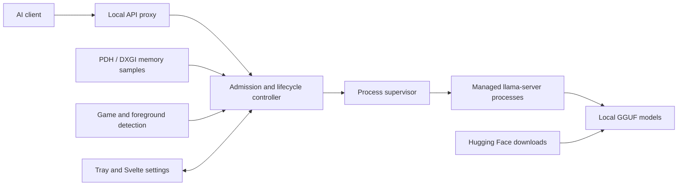
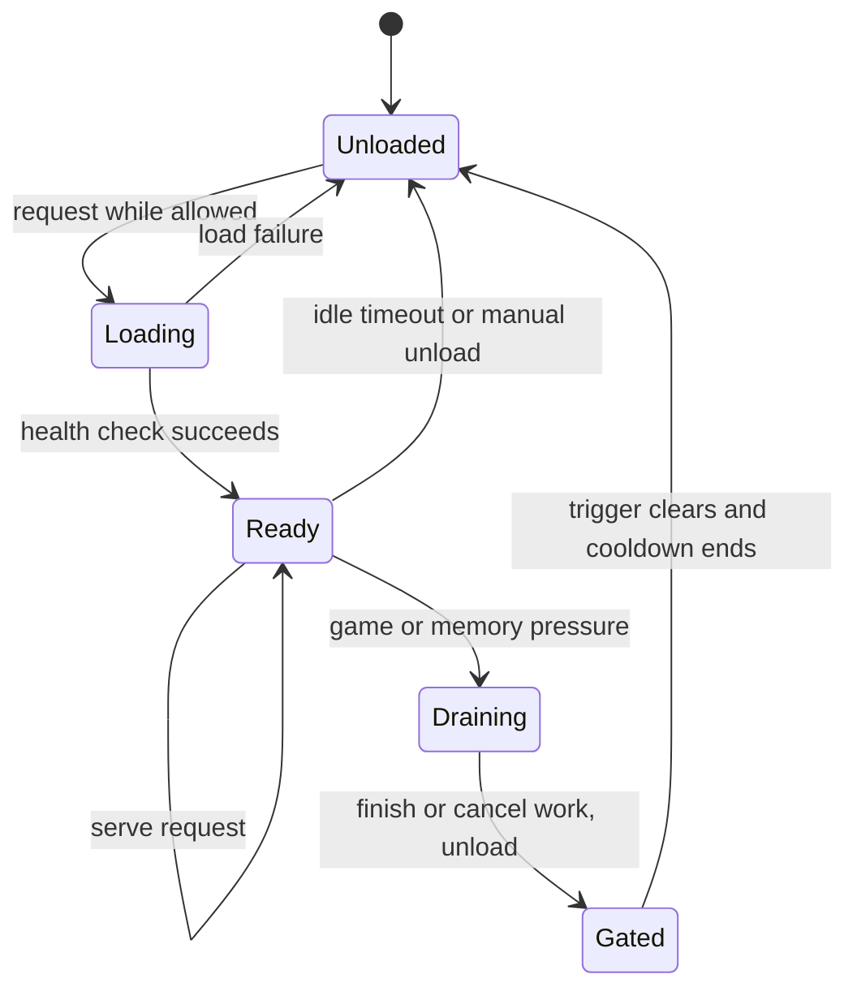

# VRAM Gatekeeper

**GPU-memory coordination for local LLMs and games on Windows.**

A Windows background application between AI clients and [llama.cpp](https://github.com/ggml-org/llama.cpp). It coordinates model loading, request admission, and GPU-memory pressure. When a configured game or pressure condition closes the gate, it can drain requests and unload managed models, then reload on demand afterward.

**Experimental alpha (v0.1.0).** A Windows installer is published on the [Releases page](../../releases) as a pre-release; it has not yet been verified on a clean machine. Hardware/game compatibility remains under validation. This is an independent project, not an official llama.cpp, NVIDIA, or game-platform product.

[Install](#install) · [Features](#features) · [Architecture](#architecture) · [Build from source](#build-from-source) · [Validation](#validation-status) · [License](#license)

## Install

Requires Windows 10 (22H2) or Windows 11, x64.

1. Download `VRAM Gatekeeper_<version>_x64-setup.exe` from the [latest release](../../releases/latest) and compare its SHA-256 with the value in the release notes. The file is about 534 MiB because it bundles two llama.cpp engines (CUDA and Vulkan).
2. Run it. It installs for the current user only: no administrator rights, no Visual C++ redistributable and no separate llama.cpp download are needed. WebView2 is installed if Windows lacks it.
3. Start **VRAM Gatekeeper**. It runs in the system tray; open the settings window from the tray icon. A discrete NVIDIA GPU uses the CUDA engine, other GPUs the Vulkan engine.

Point a client's OpenAI-style base URL at `http://127.0.0.1:8088/v1` (Anthropic-style requests use `/v1/messages`). The port is configurable, and the Status page shows the exact URLs and the model name to enter for each model.

The installer is a pre-release build. The unresolved acceptance cases under [Validation status](#validation-status) apply to it.

## Purpose

A local LLM and a game compete for dedicated GPU memory. Closing the chat window does not necessarily unload the model. Gatekeeper provides one place to manage model lifetime, explain why inference is unavailable, and restore service afterward. It manages its own `llama-server` child processes; it cannot promise to free memory allocated by unrelated programs or manage every LLM application.

## Features

- Local proxy for supported OpenAI-style and Anthropic-style llama.cpp requests, including streaming/cancellation.
- Per-model supervision, on-demand loading, idle unloading, and configurable request-drain policies.
- Windows PDH/DXGI memory monitoring, pressure thresholds, and game/foreground detection.
- Tauri tray host with a Svelte settings window created when opened and destroyed when closed.
- Hugging Face browsing, resumable downloads, and a local model library.
- CUDA/Vulkan engine selection and official llama.cpp engine updates with checksum verification, with rollback to the bundled engine.
- The full `llama-server` parameter set per model, shown with readable names and generated from `llama-server --help`.
- Speculative decoding per model: separate draft model, EAGLE-3, DFlash, DSpark, Multi-Token Prediction and n-gram types.
- Per-user NSIS installer that bundles the CUDA and Vulkan engines.
- Fake-server, fixture, property, unit, and opt-in real-engine tests.

Hardware acceptance coverage is tracked in the [manual test matrix](docs/testing/manual-test-matrix.md).

## AI-assisted development

Most of the implementation was generated with AI assistance. The application has been used and manually tested daily on one development setup; a comprehensive review of the generated code has not been completed. The [validation record](docs/PUBLICATION_CHECKS.md) identifies the automated checks performed and the acceptance work that remains.

Design/status documents and captured test output record development history; they are not a substitute for independently rerunning tests. Contributions that simplify the implementation, improve correctness, and reproduce real hardware/game behavior are especially welcome.

## Architecture



The gate decides whether a request may proceed. The supervisor owns engine processes; the proxy tracks in-flight work so unloading follows the selected drain policy.



This diagram simplifies error recovery, manual holds, and per-model policies. See the [design](docs/spec.md) and [architecture decisions](docs/adr/).

## Build from source

A **local Windows x64 checkout** is simplest. Prerequisites: a working GPU driver, Rust stable/MSVC target, Visual Studio C++ Build Tools and Windows SDK, Node.js, PowerShell 7, and WebView2 for the desktop UI. Backend compatibility depends on the selected upstream llama.cpp build.

From the repository root:

```powershell
pwsh tools/ui.ps1 install
pwsh tools/fetch-engine.ps1
pwsh tools/ui.ps1 build
$env:GATEKEEPER_BUNDLED_ENGINES = Join-Path $PWD 'app/src-tauri/resources/engine'
cargo run --locked -p vram-gatekeeper
```

The fetch script downloads pinned upstream assets from [engine-rules.json](tools/engine-rules.json); CUDA assets can be large. The git repository contains no engines, model weights, or installers; installers are attached to GitHub releases instead. Review third-party terms before redistributing a bundle.

For development alongside an existing installation, isolate local settings:

```powershell
$env:GATEKEEPER_CONFIG_DIR = Join-Path $PWD '.local-config'
$env:GATEKEEPER_DATA_DIR = Join-Path $PWD '.local-data'
cargo run --locked -p vram-gatekeeper
```

Open settings from the tray, add a model, select a compatible engine, and configure game/pressure behavior. Point a compatible client's OpenAI-style base URL at `http://127.0.0.1:8088/v1` and use the configured model ID. A request may trigger a cold model load. The headless runner exposes the same core:

```powershell
cargo run --locked -p gatekeeper-cli -- --help
```

Developers can package an NSIS installer with `cargo install tauri-cli --version "^2" --locked` followed by `pwsh tools/build.ps1`. That script fetches missing engines and creates a new numbered output under `builds/<version>-build.<NNNN>/` (git-ignored; old builds are kept). Keep the cargo target directory on a local disk (`CARGO_TARGET_DIR`), because Windows will not run freshly built programs from a network drive. Clean-machine installation still requires its own validation.

## Validation status

See the [dated public-source check results](docs/PUBLICATION_CHECKS.md) for the checks actually rerun on this publication copy.

Daily use is one setup's experience, not a compatibility guarantee. [Historical findings](docs/phase0-findings.md), [implementation tracking](docs/IMPLEMENTATION_STATUS.md), and the [manual matrix](docs/testing/manual-test-matrix.md) distinguish prior evidence from remaining work. Unresolved acceptance cases include:

- Real Steam/non-Steam, full-screen, and borderless games. Recorded detection used a renamed test process rather than a real game.
- Oversized models and real NVIDIA shared-memory fallback/pressure.
- AMD/Intel Vulkan hardware, multi-model contention, sleep/resume, and second-machine LAN behavior.
- Clean-account installation/uninstallation and the full 24-hour soak.

Real-engine and live-network tests are opt-in and may skip when their environment variables are unavailable. Review the test summary before interpreting a run as hardware or network validation.

Checks that do not load a model:

```powershell
cargo fmt --all --check
cargo test --locked -p gatekeeper-core --lib -- --skip gpu::windows_monitor::tests::adapter_counters_agree_with_nvidia_smi
cargo test --locked -p gatekeeper-core --test real_engine_fixtures
pwsh tools/ui.ps1 check
pwsh tools/ui.ps1 lint
```

The included CI workflow is configured to run formatting, core/fixture tests, and UI checks. It does not install the application, download models, run games, or validate GPU hardware.

## Network and downloads

The proxy binds to loopback by default. Optional LAN mode should be configured deliberately with authentication and has not been fully validated from a second machine. Keep private settings, tokens, diagnostic exports, and models out of Git.

The engine updater restricts install plans to official llama.cpp release-download URLs, requires published SHA-256 digests, verifies downloaded files, and rejects archive paths escaping extraction. These are implemented safeguards, not a complete security audit. Hugging Face access and model licenses are separate.

## Source map

| Path | Purpose |
|---|---|
| `crates/gatekeeper-core` | Lifecycle, monitoring, proxy, downloads, configuration |
| `crates/gatekeeper-cli` | Headless runner |
| `app/src-tauri` | Tray host and command bridge |
| `app/ui` | Svelte interface |
| `tools/fake-llama-server` | Process/proxy test double |
| `tools/` | Engine fetching, UI tooling, icons, packaging |
| `docs/` | Design, decisions, historical findings, manual matrix |

## License

Original application source is under the [MIT License](LICENSE). Dependencies, engines/runtimes, and downloaded models retain their own licenses. See [third-party notices](app/src-tauri/resources/THIRD_PARTY_NOTICES.txt); the repository contains no engine/runtime binaries, but the release installer bundles llama.cpp (MIT), its libomp runtime and the NVIDIA CUDA runtime libraries under the terms listed there.
