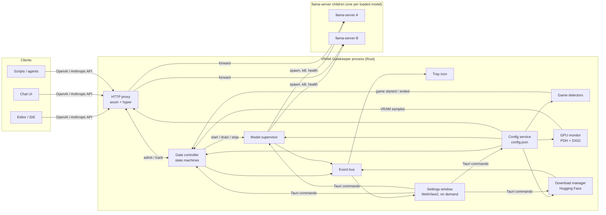
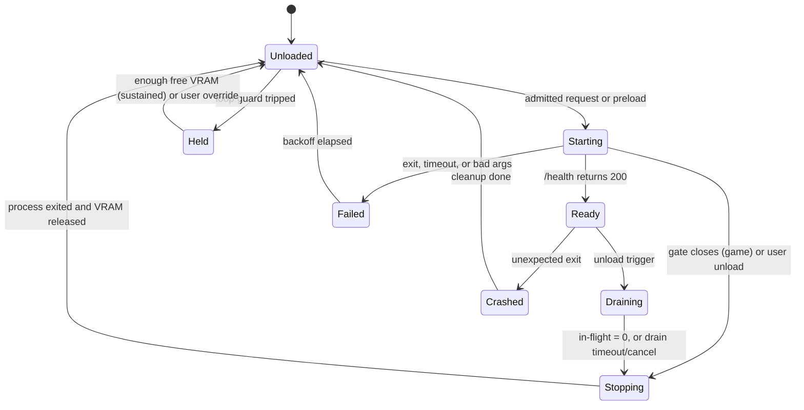

# VRAM Gatekeeper — Project Specification

> **Working title:** VRAM Gatekeeper (rename freely; the name appears in folder names, the window, the tray and the installer).
> **Platform:** Windows 10 (22H2) and Windows 11, x64.
> **Stack:** Rust (core + host) and Tauri v2 (settings UI), driving `llama-server` from llama.cpp.
> **Audience:** personal use first, public release later.
> **Document status:** living specification. It describes the app as built, plus decided work that is not built yet, which is marked **Planned** wherever it appears. Progress per phase and requirement is tracked in `docs/IMPLEMENTATION_STATUS.md`; deliberate departures from earlier versions of this document are recorded as ADRs in `docs/adr/`. `spec.md` at the repository root is kept identical to `docs/spec.md`.
> **Date:** October 2026.

---

## Table of contents

1. [Purpose and scope](#1-purpose-and-scope)
2. [Requirements](#2-requirements)
3. [Platform facts this design relies on](#3-platform-facts-this-design-relies-on)
4. [Key decisions](#4-key-decisions)
5. [Architecture](#5-architecture)
6. [Repository layout](#6-repository-layout)
7. [State machines](#7-state-machines)
8. [Request proxy](#8-request-proxy)
9. [Model supervisor (llama-server management)](#9-model-supervisor-llama-server-management)
10. [Per-model parameters (the full llama-server surface)](#10-per-model-parameters-the-full-llama-server-surface)
11. [Game detection](#11-game-detection)
12. [GPU and VRAM monitoring](#12-gpu-and-vram-monitoring)
13. [VRAM rules: pressure, overflow, loop guard](#13-vram-rules-pressure-overflow-loop-guard)
14. [Configuration file (JSON)](#14-configuration-file-json)
15. [Hugging Face model downloads](#15-hugging-face-model-downloads)
16. [llama.cpp engine management](#16-llamacpp-engine-management)
17. [GUI and tray](#17-gui-and-tray)
18. [Efficiency budget](#18-efficiency-budget)
19. [Security](#19-security)
20. [Logging and diagnostics](#20-logging-and-diagnostics)
21. [Error handling and edge cases](#21-error-handling-and-edge-cases)
22. [Testing strategy](#22-testing-strategy)
23. [Code quality and commenting standards](#23-code-quality-and-commenting-standards)
24. [Dependencies](#24-dependencies)
25. [Build, packaging and distribution](#25-build-packaging-and-distribution)
26. [Implementation phases](#26-implementation-phases)
27. [Risks and open items](#27-risks-and-open-items)
28. [Glossary](#28-glossary)
29. [Sources](#29-sources)

---

## 1. Purpose and scope

### 1.1 Problem

A local LLM loaded into GPU memory competes with games and other GPU-heavy applications. On Windows this rarely produces a clean "out of memory" error. Instead, the graphics driver spills allocations into system RAM, and both the game and the model slow down badly. Users currently have to remember to unload models by hand before playing, then reload them afterwards.

### 1.2 What the app does

VRAM Gatekeeper is a background app that sits between AI clients (editors, chat UIs, scripts, agents) and one or more `llama-server` processes. It:

1. **Unloads models when a game starts**, after letting in-progress requests finish according to a user-selected policy. While the game runs, requests receive a clear "model not loaded" error instead of hanging or loading the model again.
2. **Reacts to VRAM pressure from other apps.** When total VRAM use crosses a threshold, it unloads models (least recently used first by default). The next request loads the model again normally.
3. **Detects when a model overflows into system RAM**, either because llama.cpp placed layers on the CPU or because the driver spilled memory. The user chooses whether that is acceptable (keep running) or should be treated as a failure (error and unload).
4. **Prevents load/unload loops** with an optional loop guard.
5. **Manages models end-to-end**: per-model llama-server parameters (the full parameter set), Hugging Face search and download, and a settings GUI. All settings live in one JSON file.

### 1.3 Non-goals for this build

- No chat, project or agent interface yet. A local chat/project/agent workspace is planned for a **later stage** (see [Phase 7](#phase-7-later-local-chat-project-and-agent-workspace)); this build is the foundation it will sit on.
- No Linux or macOS support. Game detection and VRAM monitoring are Windows-specific by design. The core logic is kept platform-neutral behind traits so a port stays possible.
- No multi-GPU model splitting management beyond passing llama.cpp's own flags through. The app monitors one GPU adapter (user-selectable).
- No inference engine of its own. llama.cpp's `llama-server` does all inference.

### 1.4 Build order

This app is built first and on its own. The chat/project/agent workspace comes later and will be a client of this app's proxy, so it automatically obeys game and VRAM rules.

---

## 2. Requirements

Each requirement has an ID that code comments, tests and commit messages can reference (for example `// Implements FR-GAME-3`).

### 2.1 Functional requirements

**Games**

| ID | Requirement |
|---|---|
| FR-GAME-1 | Detect when a game starts and when it exits. |
| FR-GAME-2 | When a game starts, immediately stop accepting new requests for every model whose game policy is `unload` (FR-GAME-7). New requests receive a "model not loaded" error. |
| FR-GAME-3 | Requests already running when the game starts are handled by the user's drain policy: always finish, finish within N seconds then cancel, or cancel immediately. |
| FR-GAME-4 | Once a model has no in-flight requests (or they were cancelled), unload it and free its VRAM. |
| FR-GAME-5 | While a game runs, requests for those models keep receiving the "model not loaded" error. |
| FR-GAME-6 | After the game exits (plus a configurable cooldown), requests load models again on demand. Optional per-model preload after the game ends. |
| FR-GAME-7 | Per-model policy: unload during games (default) or keep available (useful for small CPU-only models). |
| FR-GAME-8 | The user can manually add any `.exe` to the game list, by browsing for the file, picking from running apps, or typing its name. Listed executables are treated as games whenever they run. |

**VRAM**

| ID | Requirement |
|---|---|
| FR-VRAM-1 | Monitor total dedicated VRAM use on the selected GPU. |
| FR-VRAM-2 | When total use stays above a user threshold for a sustain period, unload models (scope: LRU-first until below threshold, or all). In-flight requests follow the drain policy. |
| FR-VRAM-3 | After a VRAM-pressure unload, the next request loads the model again normally. |
| FR-VRAM-4 | Detect when a loaded model overflows into system RAM (CPU-offloaded layers at load, or driver spill at runtime). |
| FR-VRAM-5 | User setting for overflow: **keep running**, or **stop with error and unload**. With "stop with error", in-flight requests for that model get an error and the model is unloaded. The next request loads it again normally. |
| FR-VRAM-6 | Loop guard (setting, on by default): after N pressure/overflow unloads within M minutes, hold the model and reject requests until enough VRAM is free to fit it (rule in §13.3), or the user releases it. |
| FR-VRAM-7 | Several models may be loaded at once. When a new model would not fit, idle models can be unloaded LRU-first to make room (setting). |

**Requests**

| ID | Requirement |
|---|---|
| FR-REQ-1 | Expose an OpenAI-compatible API (plus the Anthropic-style `/v1/messages` endpoint and llama.cpp native endpoints that llama-server supports). |
| FR-REQ-2 | Route requests to the right model using the `model` field. |
| FR-REQ-3 | Load an unloaded model on demand when no gate reason blocks it (§7.3), and make the request wait until the model is ready (up to the model's load timeout). |
| FR-REQ-4 | Return structured, configurable errors (status code, `Retry-After`, machine-readable reason). |
| FR-REQ-5 | Support streaming responses, including clean error delivery when a stream must be cancelled. |

**Models and settings**

| ID | Requirement |
|---|---|
| FR-MOD-1 | Each model has its own settings page exposing **every** llama-server parameter supported by the installed engine, plus app-level lifecycle settings. |
| FR-MOD-2 | All global and per-model settings are stored in **one JSON file**. |
| FR-MOD-3 | Settings can be changed from the GUI or by editing the JSON file by hand; both paths are validated. |
| FR-MOD-4 | Search Hugging Face for GGUF models and download them from inside the app (resume, verify, cancel). |
| FR-MOD-5 | Show the exact llama-server command line each model will be launched with. |
| FR-MOD-6 | Each model can use speculative decoding (separate draft model, EAGLE-3, DFlash, DSpark, Multi-Token Prediction, n-gram types) from a dedicated settings tab; every other speculative parameter stays available in the generic editor (§10.6). |
| FR-MOD-7 | The memory a draft file needs is counted in footprint estimates and invalidates learned measurements, and a draft file cannot be deleted while a model uses it. |
| FR-MOD-8 | Draft files can be downloaded from Hugging Face and attached to a model from the Download page. Sidecar files in a model repository (MTP heads, DFlash and DSpark drafts) are recognised and attached to the model they belong to, and other draft models can be found by search (§10.6, §15.2). |
| FR-MOD-9 | Speculative setups that are likely to fail (missing draft file, draft type without a file, vocabulary mismatch, MTP without MTP layers) are reported before the model is loaded, and Test Load reports which speculative types the engine actually started. |

**App**

| ID | Requirement |
|---|---|
| FR-APP-1 | Runs in the background with a tray icon; GUI window opens on demand. |
| FR-APP-2 | Starts with Windows (setting). |
| FR-APP-3 | Manual controls: unload now, allow anyway (override until the game ends), pause gating. |
| FR-APP-4 | Notifications on state changes (setting). |

### 2.2 Non-functional requirements

| ID | Requirement |
|---|---|
| NFR-1 | Idle with the window closed and no model loaded: ≤ 30 MB private memory, ≤ 0.1% average CPU, zero WebView2 processes owned by the app. |
| NFR-2 | Game start to "requests rejected": ≤ 1 second with the foreground hook, ≤ scan interval otherwise. |
| NFR-3 | No admin rights required for install or operation. |
| NFR-4 | Anti-cheat friendly: never inject into, hook, or open handles to game processes. |
| NFR-5 | Crash-safe: if the app dies, its llama-server children die with it; the config file is never left half-written. |
| NFR-6 | Code is thoroughly commented for review (see [§23](#23-code-quality-and-commenting-standards)). |
| NFR-7 | Self-contained install: the installer bundles every runtime dependency (llama.cpp `llama-server` with its backend DLLs, the CUDA runtime where applicable, and the WebView2 bootstrapper), and the Rust binary is statically linked against the C runtime. A user installs nothing else, and the app works offline on first run with the bundled engine. See [§25.2](#252-bundled-dependencies). |

### 2.3 Decisions confirmed with the owner

| Topic | Decision |
|---|---|
| GPUs | NVIDIA, AMD and Intel (discrete). |
| Models | Several models may be loaded at the same time. |
| VRAM pressure | Unload; the next request reloads normally. |
| Overflow into RAM | User setting: keep running, or error and unload. Next request reloads normally. |
| Loop guard | Yes, as a setting, on by default. |
| Draining | User setting (finish / wait N seconds then cancel / cancel immediately). |
| Settings storage | One JSON file for global and per-model settings. |
| Model downloads | In-app Hugging Face search and download. |
| Audience | Personal first, public later. |
| Code | Detailed comments throughout; the owner reviews the code. |
| Later stage | Local chat/project/agent workspace, after this app is complete. |
| Dependencies | The app ships with everything it needs, including llama.cpp and its runtime libraries. Users do not install llama.cpp, the CUDA runtime, the Visual C++ redistributable or WebView2 separately (D11, NFR-7). |

---

## 3. Platform facts this design relies on

These were checked before making the decisions in §4. Each one has a spike in [Phase 0](#phase-0-technical-spikes) to confirm it on real hardware before the code depends on it.

| # | Fact | Consequence for the design |
|---|---|---|
| F1 | On Windows, NVIDIA's "CUDA – Sysmem Fallback Policy" lets CUDA allocations spill into system RAM instead of failing. Setting it to "Prefer No Sysmem Fallback" makes llama.cpp fail with an out-of-memory error instead. | VRAM overflow usually appears as a slowdown, not an error. The app must detect spill itself (F2) and can't rely on llama.cpp erroring. |
| F2 | Windows publishes vendor-neutral GPU performance counters (the same data Task Manager shows): `\GPU Adapter Memory(*)\Dedicated Usage`, `\GPU Adapter Memory(*)\Shared Usage`, `\GPU Process Memory(*)\Dedicated Usage`, `\GPU Process Memory(*)\Shared Usage`, and `\GPU Engine(*)\Utilization Percentage`. | One monitoring backend covers NVIDIA, AMD and Intel without vendor SDKs. Per-process counters let us attribute VRAM to each llama-server and detect spill. |
| F3 | Counter names are localized on non-English Windows. | Use `PdhAddEnglishCounterW`, never `PdhAddCounterW`. |
| F4 | Per-process GPU memory counters can over-report (Microsoft KB 4490156), and committed memory can exceed physical VRAM. | Use the **adapter-level** counter for pressure decisions. Use per-process counters only for attribution and spill detection, relative to a baseline. |
| F5 | On integrated GPUs, "dedicated" memory is a small carve-out and dedicated counters read near zero. | VRAM features are disabled on iGPU-only systems (with an explanation in the UI). Game detection still works. |
| F6 | `SHQueryUserNotificationState` returns `QUNS_RUNNING_D3D_FULL_SCREEN` for exclusive full-screen Direct3D apps, and `QUNS_BUSY` for any full-screen app (including videos and presentations). | Exclusive full-screen counts as a game. `QUNS_BUSY` alone is too broad and only counts when the heavy-GPU heuristic agrees. |
| F7 | Steam writes the running game's app ID to `HKCU\Software\Valve\Steam\RunningAppID` (0 when nothing is running). | Event-driven Steam detection via `RegNotifyChangeKeyValue`, no polling. |
| F8 | llama.cpp now auto-fits models to free device memory (`--fit`, on by default with `-ngl auto`), moving layers to system RAM when VRAM is short. | A reload under pressure may succeed with CPU-offloaded layers. That counts as "overflow into RAM" (FR-VRAM-4), so it must be detected at load time. |
| F9 | A streaming generation in llama-server aborts when its HTTP connection drops. | Closing the upstream connection cancels generation. As a backstop, unloading kills the process anyway. |
| F10 | llama.cpp's router-mode idle sleep (`--sleep-idle-seconds`) unloads weights but leaves the child process attached to the GPU with roughly 600 MiB still allocated. | The app runs **one llama-server process per model** and terminates it to unload. Termination guarantees the driver frees everything. |
| F11 | llama.cpp publishes Windows release zips per backend: CPU, CUDA (12.x and 13.x, with a separate `cudart` runtime zip), Vulkan (works on NVIDIA, AMD and Intel), ROCm/HIP for AMD, and SYCL. Asset names have changed over time (for example the AMD HIP build was renamed). | The engine manager matches assets by configurable patterns, not hard-coded names. |
| F12 | A Tauri v2 app can run tray-only with no window, create its WebView only when the window opens, and destroy the WebView process tree when the window closes. | One process can host both the always-on core and the on-demand UI with no idle WebView cost (see D2). |
| F13 | The Hugging Face Hub API offers model search (`/api/models?search=…&filter=gguf`), recursive file listing (`/api/models/{repo}/tree/{rev}?recursive=true`), and downloads from `/{repo}/resolve/{rev}/{path}` (redirected to a CDN, supports HTTP `Range`). | Downloads are implemented with our own HTTP client for progress, resume, cancel and hash verification. |

---

## 4. Key decisions

Each decision gets a full Architecture Decision Record (ADR) in `docs/adr/` during Phase 0. Summary:

### D1. Rust for all always-on logic

The background work (HTTP proxy, monitors, process supervision) runs continuously, so it should have no garbage collector and a small footprint. Rust also has first-class Windows bindings (`windows` crate) and a mature async stack (`tokio`, `hyper`, `axum`).

### D2. One process, with the WebView created on demand

**This revises the earlier two-process suggestion (separate service + GUI).** After checking how Tauri v2 behaves (F12), a single process gives the same idle efficiency with less complexity:

- The core runs on Tauri's tokio runtime from startup.
- The tray icon is native (no WebView).
- The settings window (WebView2) is created when opened and **destroyed** (not hidden) when closed, which ends its WebView2 child processes.
- No inter-process communication layer is needed: the UI calls Rust directly through Tauri commands.

Robustness is preserved by structure, not by process separation:

- All logic lives in a separate `gatekeeper-core` crate with **no Tauri dependency**. It can be tested on its own and run headless through a small CLI binary.
- WebView2 renderers already run in separate processes, so a UI crash doesn't take down the core.
- Panics in command handlers are caught and logged; they never cross into the core's tasks.

### D3. One llama-server process per model, killed to unload

See F10. It gives exact VRAM attribution per model (per-process counters), guaranteed release on unload, and independent crash isolation. llama.cpp's router mode is not used.

### D4. The app owns the request path through a proxy

Clients talk only to the gatekeeper. llama-server children bind to `127.0.0.1` on random ports with a random per-launch API key, so nothing can bypass the gate.

### D5. Vendor-neutral GPU monitoring through Windows performance counters

Windows' GPU counters (F2) replace vendor SDKs, covering NVIDIA, AMD and Intel with one code path. DXGI supplies adapter names, LUIDs and total VRAM.

### D6. Event-driven detection, light polling only where needed

- Foreground window changes: `SetWinEventHook` (event-driven, out-of-context, no injection).
- Steam: registry change notification (event-driven).
- Process list: a `CreateToolhelp32Snapshot` scan every 3 seconds as the catch-all. This takes about a millisecond and opens no process handles.
- WMI process-start events were rejected: `Win32_ProcessStartTrace` requires admin, and `__InstanceCreationEvent` polls internally with more overhead than a snapshot.
- GPU counters are sampled every second only while a model is loaded, a game is running, or the loop guard is holding a model. Otherwise every 10 seconds, or not at all. Both intervals and the idle switch are settings (§12.3).

### D7. Settings in one JSON file, with a generated JSON Schema

As requested, `config.json` holds all global and per-model settings. JSON has no comments, so documentation lives in a generated `config.schema.json` (from the Rust types via `schemars`). The config file references it with `$schema`, so editors such as VS Code show descriptions, defaults and validation while hand-editing.

**One deliberate exception:** secrets (the Hugging Face token and the API key) are stored in Windows Credential Manager, not in the JSON file. The JSON records only whether a secret is set. This keeps the file safe to share, back up or paste into a bug report. Runtime-learned data (measured model footprints, last-used times) is not a setting and goes in a separate `state.json`.

### D8. Full llama-server parameter coverage via a generated parameter catalog

llama-server has well over 100 flags, and they change between releases. Hard-coding them would always be out of date. Instead, the app runs `llama-server --help` for the installed engine, parses it into a **parameter catalog**, and the GUI renders an editor for every parameter from that catalog. A small curated overlay shipped with the app improves widgets and grouping for common parameters. See [§10](#10-per-model-parameters-the-full-llama-server-surface).

### D9. Own Hugging Face downloader instead of llama-server's `-hf`

llama-server can download models itself, but downloading during a load gives no progress UI, no resume, no queue, and mixes a slow network operation into the request path. The app downloads into its own model library and launches llama-server with plain file paths.

### D10. Svelte 5 + TypeScript for the UI

Svelte compiles to small bundles with little runtime, which keeps window-open memory low. Its syntax is readable for review. The TypeScript types for commands and events are written by hand in `types.ts`, and a drift test fails when a Rust field or event is missing from them, so the UI and the core can't drift apart silently. (ADR-0012 replaced the original plan to generate them with `tauri-specta`.)

### D11. Ship llama.cpp and all runtime libraries inside the installer

**Added at the owner's request; this replaces the earlier plan to have users supply their own llama.cpp build until Phase 5.**

- A build-time script (`tools/fetch-engine.ps1`) downloads a **pinned** llama.cpp Windows release for each backend listed in `engine-rules.json` (Vulkan and CUDA), plus the matching `cudart` zip for the CUDA build. It verifies SHA-256 hashes and stages the files under `app/src-tauri/resources/engine/<backend>/`. The WebView2 bootstrapper is not fetched by the script; the Tauri bundler embeds it in the installer (§25.2).
- The Tauri bundler packs `resources/` into the per-user installer. On first run, `engine.llama_server_dir = null` means "use the bundled engine".
- The Rust binary links the C runtime statically (`+crt-static`), so the Visual C++ redistributable is not needed.
- Users may still point the app at their own build, or download newer engines in the app (§16.2). The bundled engine stays as the rollback target.
- Developer toolchain (Rust, MSVC Build Tools, Node) is **build-time only** and never part of the install.

---

## 5. Architecture

### 5.1 Component diagram



### 5.2 Runtime model

- **Single process**, single tokio multi-threaded runtime (Tauri's), with worker threads capped at 2. The load is I/O-bound and tiny.
- **Dedicated OS threads** only where Windows requires a message loop or blocking wait:
  - `foreground-hook` thread: runs `SetWinEventHook` and a `GetMessageW` loop.
  - `registry-watch` thread: blocks in `RegNotifyChangeKeyValue` for Steam.
  - Both forward events into tokio through channels.
- **Actors over shared locks.** The gate controller is a single task that owns all lifecycle state and processes messages in order. This removes most race conditions by construction: every state transition happens in one place, one message at a time. Other components send it messages (`RequestAdmission`, `GameStarted`, `VramSample`, `ModelExited`, …) and receive replies over oneshot channels.
- **Event bus:** a `tokio::sync::broadcast` channel of `AppEvent`s (state changes, VRAM samples, log lines, download progress). The tray subscribes always; the UI bridge subscribes only while the window exists.

### 5.3 Request flow (happy path)

1. Client sends `POST /v1/chat/completions` with `"model": "qwen3-8b"`.
2. Proxy reads the body (size-limited), extracts `model` and `stream`.
3. Proxy asks the gate controller for admission. The controller checks gate reasons and the model's state, starts the model if it's unloaded and allowed, and replies with either `Admitted { upstream, inflight_guard, cancel_token }` or `Rejected { reason }`.
4. Proxy waits for readiness if the model is starting (bounded by `load_timeout_seconds`).
5. Proxy forwards the request to the child, replacing client auth with the child's per-launch key.
6. Proxy streams the response back. The in-flight guard decrements on completion, error, or client disconnect (RAII `Drop`).

---

## 6. Repository layout

```
vram-gatekeeper/
├─ Cargo.toml                      # Workspace definition, shared lint settings
├─ rust-toolchain.toml             # Pinned stable toolchain
├─ deny.toml                       # cargo-deny: licenses and advisories
├─ README.md
├─ CHANGELOG.md
├─ spec.md                         # Identical copy of docs/spec.md
├─ builds/                         # Versioned installer builds (§25.4.1); git-ignored
├─ docs/
│  ├─ adr/                         # Architecture Decision Records (0001–0013)
│  ├─ spec.md                      # This document
│  ├─ IMPLEMENTATION_STATUS.md     # Progress per phase and requirement ID
│  ├─ phase0-findings.md           # Spike measurements on real hardware
│  └─ testing/manual-test-matrix.md
├─ crates/
│  ├─ gatekeeper-core/             # ALL logic. No Tauri dependency.
│  │  ├─ src/
│  │  │  ├─ lib.rs                 # Crate docs, public API surface
│  │  │  ├─ app.rs                 # Wires components together; start/stop; folders
│  │  │  ├─ events.rs              # AppEvent enum and the broadcast bus
│  │  │  ├─ ports.rs               # Traits the core depends on (launcher, killer, health probe, state and secret stores)
│  │  │  ├─ state_store.rs         # state.json (footprints, LRU times)
│  │  │  ├─ diagnostics.rs         # Diagnostics bundle
│  │  │  ├─ error.rs, sync.rs
│  │  │  ├─ config/                # schema.rs, defaults.rs, validate.rs, store.rs (atomic save, file watching), migrate.rs
│  │  │  ├─ gate/                  # controller.rs (the actor), gate_state.rs, model_state.rs, drain.rs, vram_rules.rs, loop_guard.rs, rejection.rs
│  │  │  ├─ proxy/                 # server.rs, routing.rs, forward.rs, inflight.rs, cancel_body.rs, errors.rs, admin_api.rs
│  │  │  ├─ supervisor/            # launcher.rs, health.rs, log_capture.rs, log_files.rs, log_parse.rs, footprint.rs, ports.rs (free-port allocation)
│  │  │  ├─ params/                # catalog.rs, help_parser.rs, overlay.rs + overlay.json, argv.rs
│  │  │  ├─ detect/                # mod.rs (GameDetector), process_scan.rs, foreground.rs, steam.rs, heavy_gpu.rs, windows_games.rs, game_list.rs (checks for new game-list entries)
│  │  │  ├─ gpu/                   # mod.rs (GpuMonitor, VramSample), sampler.rs, instance.rs (counter instance names), windows_monitor.rs
│  │  │  ├─ hf/                    # api.rs, gguf_files.rs, view.rs, download.rs, queue.rs, library.rs, update.rs (model update checks)
│  │  │  ├─ gguf/header.rs         # Minimal GGUF metadata reader
│  │  │  ├─ engine/                # install.rs, bundled.rs, updater.rs
│  │  │  └─ platform/windows/      # Thin, commented unsafe wrappers (PDH, DXGI, job object, process list, foreground hook, registry, credentials, power, disk, windows)
│  │  └─ tests/                    # ui_types_drift.rs, real_engine_e2e.rs, real_engine_fixtures.rs, live_hf.rs, fixtures/
│  └─ gatekeeper-cli/              # Headless runner for development/tests
├─ app/
│  ├─ src-tauri/
│  │  ├─ src/                      # main.rs, core_boot.rs, state.rs, commands.rs, ui_bridge.rs, window.rs, tray.rs, tray_model.rs, tray_icons.rs
│  │  ├─ build.rs                  # Lists the commands the page may invoke
│  │  ├─ capabilities/             # Tauri v2 permission files
│  │  ├─ resources/                # Staged engines (git-ignored) and THIRD_PARTY_NOTICES.txt
│  │  └─ tauri.conf.json
│  └─ ui/                          # Svelte 5 + TypeScript + Vite
│     └─ src/
│        ├─ lib/types.ts           # Hand-written mirror of the Rust types, checked by ui_types_drift.rs (ADR-0012)
│        ├─ lib/                   # api.ts, live.svelte.ts, draft.svelte.ts, strings.ts, paramLabels.ts, format.ts, ...
│        ├─ components/            # Field, Hint, Toggle, NumberField, ListEditor, PathPicker, ParamEditor, SaveBar, StatusChip, VramBar, VramChart
│        └─ pages/                 # Status, Logs, Models, Download, Games, VramRequests, Engine, General
└─ tools/
   ├─ fake-llama-server/           # Test double that mimics llama-server
   ├─ fetch-engine.ps1             # Downloads and verifies the pinned llama.cpp builds and cudart (D11)
   ├─ engine-rules.json            # Pinned release tag, asset name patterns, SHA-256 hashes
   ├─ build.ps1                    # Versioned installer build (§25.4.1)
   ├─ ui.ps1                       # UI install/check/lint/build; mirrors to a local disk when the repo is on a network drive
   └─ make-icons.py
   # Staged output (git-ignored): app/src-tauri/resources/engine/
```

---

## 7. State machines

### 7.1 Gate (global)

The gate is a **set of active blocking reasons**, not a single enum. Multiple reasons can be active at once (a game is running *and* the user paused). Each reason applies to a set of models.

| Reason | Applies to | Set by | Cleared by |
|---|---|---|---|
| `Game { name, source }` | Models with `game_policy = "unload"` | Any game detector positive | All detectors negative for `cooldown_seconds` |
| `Paused` | All models | **Pause Gatekeeper** (Status page), the tray's pause item, or `POST /gatekeeper/v1/pause` | **Resume** in the same places, or `POST /gatekeeper/v1/resume` |
| `ManualUnloadHold` | One model | **Unload and Hold** (Status page), or the admin `unload` endpoint with `"hold": true` | **Release** (Status page), the tray's **Release held models**, or `POST /gatekeeper/v1/models/{id}/release` |

**Overrides:** "Allow anyway" suppresses the `Game` reason until the current game session ends. It doesn't persist across sessions.

The **game session** begins when the first detector reports a game and ends when the cooldown completes. Draining happens once per session.

### 7.2 Model lifecycle (per model)



**Unload triggers** (each carries a `cause` used for error messages and the loop guard):

| Cause | Source | New requests during Draining/Stopping | In-flight requests |
|---|---|---|---|
| `Game` | Gate reason added | Rejected (`game_running`) | Drain policy |
| `VramPressure` | §13.1 | **Queued**; they trigger a reload once Unloaded | Drain policy |
| `Overflow` (setting = error) | §13.2 | Queued; trigger reload | **Cancelled with error** |
| `IdleTtl` | `idle_unload_minutes` elapsed | Queued; trigger reload | None by definition |
| `MakeRoom` | §13.4 | Queued; trigger reload | Only idle models are chosen |
| `User` | Tray / GUI / admin API | Queued; trigger reload (unless "hold") | Drain policy |
| `ConfigChange` | Restart-required setting edited | Queued; trigger reload | Drain policy |

Queuing during pressure/overflow unloads matters: FR-VRAM-3 says the *next* request reloads normally, so those requests wait (up to `load_timeout_seconds`) rather than fail.

Two exceptions end the wait early:

- If the unload trips the loop guard (§13.3), the model moves to `Held` and every queued request is rejected with `vram_guard`.
- If a game session starts while requests are queued, they are rejected with `game_running` (for models with `game_policy = "unload"`).

### 7.3 Admission algorithm

Executed inside the controller actor for every request:

```
admit(model_id):
  model = config.models[model_id]            -> 404 unknown_model if absent or disabled
  if gate.blocks(model):                      -> reject(reason)          # game_running / paused
  if model.state == Held:                     -> reject(vram_guard)
  match model.state:
    Ready      -> issue InflightGuard, return upstream
    Starting   -> enqueue waiter; return on Ready / reject on failure
    Draining | Stopping (cause not Game)
               -> enqueue waiter; start again after Unloaded
    Unloaded   -> make_room_if_needed(model); start(model); enqueue waiter
    Failed     -> reject(model_load_failed, retry_after = remaining backoff)
```

Every waiter has a deadline (`load_timeout_seconds`). On expiry it receives `load_timeout` (HTTP 504).

### 7.4 Drain execution

When a model enters `Draining` with cause *c* and drain policy *p*:

| Policy (`draining.policy`) | Behaviour |
|---|---|
| `finish` | Wait until in-flight = 0, with no time limit. |
| `wait_then_cancel` | Wait up to `draining.timeout_seconds`, then cancel the rest. |
| `cancel` | Cancel all in-flight requests immediately. |

The overflow cause with action `error_and_unload` always cancels immediately, regardless of policy, because the user chose "error".

Cancelling a request means: trigger its `CancellationToken`. The response body wrapper sends the error (§8.5) and closes the client connection; dropping the upstream connection stops generation in llama-server (F9). The model then moves to `Stopping` and its process is killed regardless, so cancellation correctness never depends on llama-server's behaviour alone.

---

## 8. Request proxy

### 8.1 Listener

- Default bind `127.0.0.1:8088` (configurable). Clients use `http://127.0.0.1:8088/v1` as their base URL.
- `allow_lan = true` binds `0.0.0.0` and **requires** an API key (validation rejects the config otherwise).
- HTTP/1.1 with keep-alive. HTTP/2 isn't needed for local clients.

### 8.2 Endpoint table

| Path | Method | Routing |
|---|---|---|
| `/v1/chat/completions` | POST | `model` field |
| `/v1/completions` | POST | `model` field |
| `/v1/embeddings` | POST | `model` field |
| `/v1/responses` | POST | `model` field (if the engine supports it) |
| `/v1/messages`, `/v1/messages/count_tokens` | POST | `model` field (Anthropic-style errors) |
| `/v1/rerank`, `/v1/reranking` | POST | `model` field |
| `/v1/models` | GET | Answered by the proxy: all enabled models, each with an added `gatekeeper` object (`state`, `blocked_reason`) |
| `/completion`, `/infill`, `/tokenize`, `/detokenize`, `/apply-template`, `/embedding` | POST | `model` field if present, else `server.default_model` |
| `/m/{model_id}/{rest...}` | any | Explicit passthrough to that model's llama-server (for native features without a `model` field) |
| `/health` | GET | The gatekeeper's own health |
| `/gatekeeper/v1/*` | various | Admin API (§8.7) |

Unknown paths return 404 with an OpenAI-format error. Whether a missing `model` field falls back to `server.default_model` or returns 400 is a setting (`server.require_model_field`, default `false`).

### 8.3 Body handling

- Bodies are read fully up to `server.max_request_body_mib` (default 64 MiB, to allow images for vision models) so the `model` field can be extracted. Over the limit → 413.
- Only `model` and `stream` are parsed (a small `serde` struct with `#[serde(default)]`); the original bytes are forwarded unmodified.
- `model` is matched against model `id` and `aliases`, case-insensitively.

### 8.4 Forwarding

- `hyper-util` client with a per-child connection pool.
- Request headers are copied except hop-by-hop headers and `Authorization` / `x-api-key`, which are replaced with `Authorization: Bearer <child key>`.
- Responses stream through unchanged, wrapped in `CancelableBody` (§8.5).
- Upstream connection errors while `Ready` → 502 `model_crashed`, and the controller is told to verify the process.

### 8.5 Error formats

All gatekeeper-generated errors use the API family's format, so client libraries surface them properly.

**OpenAI family (non-streaming):**

```json
{
  "error": {
    "message": "Model 'qwen3-8b' is not loaded because a game is running (eldenring.exe). Retry after the game closes.",
    "type": "model_not_loaded",
    "code": "game_running",
    "param": null,
    "gatekeeper": {
      "model": "qwen3-8b",
      "reason": "game_running",
      "detail": { "game": "eldenring.exe", "source": "process_list" },
      "retry_after_seconds": 30
    }
  }
}
```

**Anthropic family (`/v1/messages`):**

```json
{
  "type": "error",
  "error": {
    "type": "model_not_loaded",
    "message": "Model 'qwen3-8b' is not loaded because a game is running (eldenring.exe)."
  }
}
```

**Streaming cancellation (response already started, status already 200):**

- OpenAI family: `data: {"error": { ...same object... }}\n\n`, then close. No `[DONE]` is sent, so clients know the stream didn't complete normally.
- Anthropic family: `event: error\ndata: {"type":"error","error":{...}}\n\n`, then close.

**Reason codes:**

| `code` | HTTP | Meaning |
|---|---|---|
| `game_running` | `errors.status_code` (503) | Blocked by the game gate |
| `paused` | 503 | Gatekeeper paused by the user |
| `vram_guard` | 503 | Loop guard is holding the model |
| `request_cancelled` | 503, or stream error event | In-flight request cancelled (detail says game / overflow / user) |
| `model_load_failed` | 503 | Model failed to start; in backoff |
| `load_timeout` | 504 | Model didn't become ready in time |
| `model_crashed` | 502 | llama-server exited unexpectedly |
| `unknown_model` | 404 | No enabled model with that id or alias |
| `model_required` | 400 | The request has no `model` field, and either `server.require_model_field` is on or no `server.default_model` is set |
| `not_found` | 404 | Unknown endpoint (or a disabled admin API) |
| `request_too_large` | 413 | Body over the limit |
| `unauthorized` | 401 | Missing or invalid API key; checked on every request except `/health` whenever a key is set, and always in LAN mode |
| `host_not_allowed` | 403 | The `Host` header is not a local name or a configured LAN name (§19) |
| `shutting_down` | 503 | The gatekeeper is stopping |

`Retry-After` is set on 503 responses: `errors.retry_after_seconds` for games and pause, the remaining backoff for load failures, and 15 seconds for `vram_guard`.

### 8.6 In-flight tracking

- `InflightGuard` is an RAII value holding the model id and request id. Creating it increments the model's counter; `Drop` decrements it and notifies the controller. It lives inside the response body, so it covers normal completion, errors, panics and client disconnects.
- The counter is an `AtomicU32` for cheap reads, but transitions decided on it go through the controller actor, which is the single source of truth.
- Each request also registers a `CancellationToken` in the model's registry so drains can cancel exactly the right set.

### 8.7 Admin API

For scripts and automation. Disabled when `server.admin_api_enabled = false`. Requires the API key whenever one is set.

| Endpoint | Purpose |
|---|---|
| `GET /gatekeeper/v1/status` | Gate reasons, per-model states, in-flight counts, last VRAM sample |
| `POST /gatekeeper/v1/models/{id}/load` | Preload a model; rejected with the usual reason code (§8.5) when a gate blocks it |
| `POST /gatekeeper/v1/models/{id}/unload` | Unload (optional body `{ "hold": true }` keeps it unloaded until released) |
| `POST /gatekeeper/v1/models/{id}/release` | Release a model held by the loop guard or by "Unload and Hold" |
| `POST /gatekeeper/v1/override` | "Allow anyway" for the current game session |
| `POST /gatekeeper/v1/pause` / `resume` | Pause or resume gating |

---

## 9. Model supervisor (llama-server management)

### 9.1 Launch

1. Resolve the engine executable: `llama-server.exe` in `engine.llama_server_dir`, or in the bundled engine when that setting is `null` (§16.1).
2. Allocate a port: bind `127.0.0.1:0`, read the port, close, use it. If the child then fails because another program took the port in the meantime (a rare race), launch again with a new port, at most 2 more times (§21).
3. Generate a random 32-byte API key (hex) for this launch.
4. Build argv from the model's settings (§10.4); add the file arguments (`--model`, `--mmproj` and, while a draft type is selected, the draft file, §10.6) and `--device` when set; add `--verbosity 4` unless the user chose a verbosity, because llama-server prints the layer-placement line (§13.2) only from level 4; then append the **reserved** args the user can't override: `--host 127.0.0.1 --port <p> --api-key <k>`.
5. Spawn with `CREATE_NO_WINDOW`, stdout/stderr piped, environment = current env + model `env` overrides.
6. Assign the child to the app's **job object** created with `JOB_OBJECT_LIMIT_KILL_ON_JOB_CLOSE`. If the app crashes or is killed, Windows kills every child.
7. Poll `GET /health` every `advanced.health_poll_interval_ms` (default 250 ms). 503 means "still loading". 200 means ready.
8. During startup, parse stderr for offload information (§13.2) and errors.

### 9.2 Stop

- llama-server holds no state worth saving, and draining already happened at the proxy, so stopping uses `TerminateProcess` on the child, then waits on the process handle.
- After exit, wait until the adapter's dedicated usage has dropped by at least 80% of the model's footprint, or `advanced.stop_release_wait_ms` (default 3,000 ms) passes, before reporting `Unloaded`. This avoids racing a game's allocation against a driver that hasn't freed memory yet.

### 9.3 Health and crashes

- While `Ready`, the child's process handle is awaited in a task. An unexpected exit → `Crashed`: waiting requests get `model_crashed`, the last 200 log lines are attached to the event, and the next request starts it again.
- Repeated start failures use exponential backoff: 10 s, doubling, capped at `advanced.load_failure_backoff_max_seconds` (default 300). The backoff resets after one successful start.

### 9.4 Logs

- Each child's stdout/stderr goes to a 2,000-line in-memory ring buffer (for the GUI) and to `logs\models\<model_id>.log` (rotated daily, kept per `logging.retention_days`).
- The GUI can show the live log for each model.

### 9.5 Footprint learning

- 5 seconds after `Ready`, read the child's `\GPU Process Memory(pid_…)\Dedicated Usage` (and `Shared Usage` as the spill baseline).
- Store in `state.json` keyed by `model_id` + a hash of the settings that affect memory: the model file, the vision projector, and the `llama_args` keys `ctx-size`, `n-gpu-layers` (all spellings), `cache-type-k`, `cache-type-v`, `batch-size`, `ubatch-size`, `parallel`, `flash-attn`, `kv-offload`, `tensor-split`, `split-mode` and `override-tensor`, plus the draft file and the speculative keys listed in §10.6. A changed setting means a new measurement.
- Before the first measurement, the footprint is estimated and labelled "estimated" in the UI. The current build estimates the size of the model file (for a split model, only the first shard) plus a 512 MiB compute margin, plus, while a draft type is selected, the draft file's size and its cache (§10.6). **Planned:** a closer estimate: the size of all shards × the share of layers on the GPU (an explicit `n-gpu-layers` N gives N ÷ the GGUF block count, at most 1; unset, `auto` or `all` count as 1), plus the KV cache computed from GGUF metadata (layers, KV heads, head size) at the configured `ctx-size` (the model's native context when unset) and cache types (f16 when unset), plus the 512 MiB margin, plus the draft file as above.

---

## 10. Per-model parameters (the full llama-server surface)

### 10.1 Goal

Every model has a settings page where **any** llama-server parameter can be set, with descriptions and defaults, for whatever engine version is installed.

### 10.2 Parameter catalog generation

When an engine is selected or updated:

1. Run `llama-server --help` (and record `llama-server --version`).
2. Parse it with `help_parser.rs`. Each llama.cpp help entry has a recognizable shape: short and long flag names, an optional value placeholder, a description that may include `(default: …)`, allowed values like `[on|off|auto]`, and `(env: LLAMA_ARG_…)`. Section headers group entries (common, sampling, server-specific).
3. Produce a `ParamCatalog` (saved to `engines\<build-id>\param-catalog.json`):

```json
{
  "engine_version": "b11292",
  "generated_at": "2026-10-21T17:44:00-07:00",
  "params": [
    {
      "key": "ctx-size",
      "flags": ["-c", "--ctx-size"],
      "value_kind": "integer",
      "placeholder": "N",
      "choices": null,
      "default": "0",
      "env": "LLAMA_ARG_CTX_SIZE",
      "section": "common",
      "description": "size of the prompt context (default: 0, 0 = loaded from model)",
      "negation_flag": null,
      "repeatable": false
    }
  ]
}
```

Value kinds: `flag` (no value), `toggle` (has `--x`/`--no-x` pair), `enum` (from `[a|b|c]`), `integer`, `float`, `string`, `path` (placeholders such as `FNAME`, `PATH`), `list` (repeatable flags).

4. Merge the curated **overlay** shipped with the app (`params/overlay.json`). It marks the reserved parameters (§10.3), corrects value types (parameters whose help says `N` but take decimals become `float`), and flags the "basic" subset the editor shows by default. Overlay entries for flags missing from the catalog are ignored, so the overlay never invents flags. Readable parameter and section names come from the UI's `paramLabels.ts` (§10.5). **Planned:** min/max ranges and units in the overlay.
5. If parsing fails for a line, the parameter still appears as a free-text `string` field, so nothing is ever hidden.

### 10.3 Reserved parameters

Managed by the app and not editable per model, because changing them would break the gatekeeper:

`--host`, `--port`, `--api-key`, `--api-key-file`, `--models-dir`, `--models-preset`, `--models-max` (router mode), `--sleep-idle-seconds`, `--ssl-key-file`, `--ssl-cert-file`, `--path`, logging-destination flags (the app captures stdout/stderr itself), the model-file flags below, the Hugging Face download flags (`--hf-repo` and its relatives, because the app downloads models itself, D9), and informational flags (`--help`, `--version`, `--list-devices`). The complete list, including short aliases, is `reserved` in `params/overlay.json`. The parameter editor does not show reserved parameters; a hover note in the editor states how many there are. A reserved key found in `llama_args` (for example from a hand edit) is not emitted, and the launch preview lists it as a warning.

Model files are not set through the generic editor, so paths can be validated and linked to the model library: the model file (`--model`) and the vision projector (`--mmproj`) are set on the **Files** tab, and the draft file (`--spec-draft-model`, aliases `-md` and `--model-draft`) on the **Speculative Decoding** tab (§10.6).

### 10.4 Storing and converting parameters

In `config.json`, each model has a `llama_args` object keyed by the **long flag name without dashes**:

```json
{
  "llama_args": {
    "ctx-size": 16384,
    "n-gpu-layers": "auto",
    "flash-attn": "auto",
    "cache-type-k": "q8_0",
    "cache-type-v": "q8_0",
    "parallel": 2,
    "temp": 0.7,
    "top-p": 0.9,
    "jinja": true
  }
}
```

For a `toggle` parameter (one that has both `--x` and `--no-x` forms), the key is the positive name (`x`) and the value is `true` or `false`; the `no-` form is never used as a key. This keeps one key per setting, so the file can't contain contradictory pairs.

Conversion to argv (`argv.rs`), driven by the catalog:

| Value kind | JSON value | Emitted |
|---|---|---|
| `flag` | `true` / `false` | `--flag` / nothing |
| `toggle` | `true` / `false` | `--x` / `--no-x` |
| `enum`, `integer`, `float`, `string`, `path` | value | `--key value` |
| `list` | array | `--key v1 --key v2` |

- Keys not set in `llama_args` are **not emitted**, so llama-server uses its own defaults.
- Keys not found in the current catalog are kept in the file, flagged with a warning in the UI ("not supported by the installed engine"), and **not emitted**. They survive engine downgrades without data loss.
- `extra_args` (array of strings) is appended verbatim after catalog args, for anything exotic. Each element is one argv entry; no shell parsing happens, so quoting can't break.
- Arguments are passed with `std::process::Command::args` (no shell), which handles Windows quoting correctly.

Sampling parameters set here (`temp`, `top-p`, …) are the **server defaults** for that model. Clients can still override them per request.

### 10.5 Model settings page sections

The model editor on the Models page has these tabs, in this order:

1. **General:** model name (the `id` clients send), display name, alternative names (aliases), enabled, notes, and **Remove This Model** (removes the entry, never the file).
2. **Files:** model GGUF (single file or the first shard of a split model), optional vision projector, and, for downloaded models, the source repository with **Check for a Newer Version** (§15.5). **Planned:** a GGUF metadata summary (architecture, parameter count, layers, native context length, quantization).
3. **Lifecycle:** idle unload time, load timeout, game policy (unload / keep), pinned (never unloaded to make room), preload when the app starts, reload after a game ends, and the per-model VRAM overrides of overflow action and loop guard (default: use the global setting).
4. **Parameters:** generated editor. A search box, a "Show All" switch (otherwise only the basic subset and parameters already set are shown), groups by section, each row showing a readable name (for example "Maximum Logical Batch Size" for `-b, --batch-size`), the current value and a Reset button. The description, the engine default and the original command-line flags appear on hover. A curated table (`paramLabels.ts`) names the known parameters; any other parameter gets a name derived from its long flag, so a raw flag is never the title. Search matches the readable name, the flags and the description. Rows with a value are highlighted.
5. **Speculative Decoding:** draft files, Multi-Token Prediction and n-gram types (§10.6).
6. **Additional Arguments:** the `extra_args` list and the `env` map.
7. **Launch and Test:** the exact command line (API key hidden; the port is chosen at launch), copyable, with any skipped settings listed; and **Test Load**, which starts the model with its saved settings, reports load time, GPU layers placed (X of Y) and GPU memory, then unloads it. Test Load is unavailable while the model has unsaved changes or is already loading or loaded, and the core refuses it while a game session is active. **Planned:** Test Load also reports which speculative types started (§10.6).
8. **Log:** live log view for this model.

Changing a parameter of a loaded model marks it "applies on next load" with a **Restart Now** button (cause `ConfigChange`, which uses the drain policy).

### 10.6 Speculative decoding

Speculative decoding drafts several tokens cheaply and has the target model verify them in one batch, which speeds up generation. It is intended to leave the output unchanged; the engine's documentation notes that exact output matching needs greedy sampling, because batched verification can differ numerically. The bundled engine (llama.cpp b11804) selects the method with `--spec-type`, a comma-separated list. The available types are read from the placeholder of the `--spec-type` entry in `--help` (`none,draft-simple,draft-eagle3,…`); the help parser reports that entry as a plain string, not as a list of choices, so the tab parses the placeholder itself.

| Type | Shown as | Draft file | Notes |
|---|---|---|---|
| `draft-simple` | Separate Draft Model | Required | A smaller model with the same vocabulary drafts the tokens. |
| `draft-eagle3` | EAGLE-3 | Required | One-layer draft that reads the target's hidden states; converted for this exact target. The engine cannot recognise it from the file, so it must be selected explicitly. |
| `draft-dflash` | DFlash | Required | Block-diffusion draft; converted for this exact target. |
| `draft-dspark` | DSpark | Required | DFlash plus a Markov head; converted for this exact target (Qwen3 backbones only, as of b11804). |
| `draft-mtp` | Multi-Token Prediction | Optional | Uses multi-token-prediction (MTP) layers, either inside the main model file or in a separate MTP head file that is passed as the draft file. |
| `ngram-simple`, `ngram-map-k`, `ngram-map-k4v`, `ngram-mod`, `ngram-cache` | N-Gram: Simple, Map (Keys), Map (Keys and Values), Module, Cache | None | Draft from n-gram statistics of the text so far. |

Engine behaviour this design relies on, checked in the b11804 source (`common/arg.cpp`, `common/speculative.cpp`, `tools/server/server-context.cpp`):

- When `--spec-type` is left at its default and a draft file is given, the engine infers the type from the file: architecture `dflash` means DFlash, or DSpark when the file has a `markov_w1.weight` tensor; a `blk.<last layer>.nextn.eh_proj.weight` tensor means MTP. A plain model or an EAGLE-3 draft is not inferred.
- A draft-file type combined with a draftless type is allowed, and the draftless type takes precedence (engine documentation). Several n-gram types may be combined.
- One draft context serves all parallel slots (one sequence per slot); it is not duplicated per slot. When the engine fits memory automatically (`--fit`), it sizes the draft or MTP context together with the target.
- If the draft model cannot be loaded, or an MTP context cannot be created, the server fails to start. If speculative setup raises an error later during start-up, the server logs it and continues **without** speculative decoding.
- The engine refuses a draft whose vocabulary does not match the target: same vocabulary type, sizes differing by at most 128 tokens, identical token text from token 5 onward, and matching beginning- and end-of-sequence settings.

**Storage (FR-MOD-6).**

- `files.draft` (optional string, default `null`) holds the draft file: a separate draft model, an EAGLE-3, DFlash or DSpark draft, or an MTP head. It is an additive field, so existing files load unchanged and `schema_version` stays 1.
- The type and its tuning live in `llama_args` under the engine's names: `spec-type` (the comma-separated string the engine takes), `spec-draft-n-max`, `spec-draft-n-min`, `spec-draft-p-min`, `spec-draft-ngl`, `spec-ngram-*` and so on. The Parameters tab shows the same keys, because it edits the same store.
- `--spec-draft-model` and its aliases (`-md`, `--model-draft`) are reserved (§10.3). The launcher emits the flag from `files.draft`, using whichever spelling the installed engine's catalog lists; if it lists none, the file is skipped with a launch warning.
- **The app never relies on the engine's type inference.** `files.draft` is passed only when `spec-type` names at least one `draft-*` type. When `spec-type` is absent ("Off") or names only n-gram types, the draft file stays in the configuration but is not passed, and the tab says so.
- A configuration written before this feature may hold `spec-draft-model` (or an alias) in `llama_args`. Like any reserved key there, it is not emitted, the launch preview warns about it, and validation reports it as a warning, so an older file still loads and saves. The Speculative Decoding tab offers **Move to Draft File**, which sets `files.draft` and removes the key; nothing changes on disk until the user saves.

**Speculative Decoding tab (Models page).**

- Shown only when the installed engine's catalog has `spec-type`; otherwise the tab states that the installed engine does not support speculative decoding. Only types the engine lists are offered; a type the app has no name for is shown with a name derived from its identifier.
- A checklist of types in three groups: draft-file types (Separate Draft Model, EAGLE-3, DFlash, DSpark), Multi-Token Prediction, and n-gram types. Every entry has a hover explanation (§23.2). No type checked means Off.
- A draft file picker, shown when a type that uses a file is checked or a file is already set. Below it, a summary read from the file: architecture, size, layer count, vocabulary size, and the kind of draft the file appears to be (same rules as the engine's inference).
- Tuning fields next to the types they belong to: draft tokens (maximum and minimum), minimum draft probability, draft GPU layers, and the sizes of each checked n-gram type. A field is shown only when the engine lists its parameter; all other speculative parameters stay on the Parameters tab.
- A status area with the validation findings below and the estimated extra GPU memory.
- When the main model contains MTP layers (`<arch>.nextn_predict_layers` greater than 0, or the nextn tensor in its last layer), the tab says that the model can use Multi-Token Prediction without a separate file.

**Validation (FR-MOD-9).** Findings use the validation mechanism with severities (§14.4) and also appear in the tab and in the launch preview. Only errors block saving.

| Condition | Severity | Message (summary) |
|---|---|---|
| `draft-simple`, `draft-eagle3`, `draft-dflash` or `draft-dspark` is checked and `files.draft` is empty | Error | This type needs a draft file. (A Warning instead, pointing to Move to Draft File, when `llama_args` still holds the old draft model key.) |
| `files.draft` is set but the file does not exist or does not start with the GGUF signature | Error | The draft file is missing or is not a GGUF file |
| `files.draft` is set and no checked type uses a file | Warning | The draft file is kept but not used |
| A draft-file type is checked together with a draftless type | Warning | The draftless type takes precedence |
| `draft-mtp` is checked, `files.draft` is empty, and the main model has no MTP layers | Warning | The model may not contain MTP layers; select an MTP head file |
| The kind of draft detected in the file contradicts the checked type (for example a DFlash file with Separate Draft Model) | Warning | The file appears to be a different kind of draft |
| Separate Draft Model is checked, and the draft and target vocabularies differ in tokenizer type or in size by more than 128 tokens | Warning | The engine will probably refuse this draft file, and the model will fail to load |
| A checked type is not listed by the installed engine | Warning | The installed engine does not support this type; it is skipped |
| `draft-eagle3`, `draft-dflash` or `draft-dspark` is checked | Information | The draft must be converted for this exact model, which the app cannot check |

The app's vocabulary check covers only the tokenizer type and the size, and only for Separate Draft Model: the other draft types legitimately use a vocabulary of their own. The engine also compares token text and the beginning- and end-of-sequence settings, so **Test Load** is the definitive check.

**Test Load (extends §10.5).** The application notes each `adding speculative implementation '<type>'` line the engine prints while a model starts (the model log is longer than the ring buffer that is kept, so the line is recorded as it passes). After the model is ready, Test Load reports each configured type as **Active**, or as **Not confirmed** when its line was not printed. A missing line does not prove the type is off (for example, the user may have lowered the log verbosity below the launcher's default of 4, §9.1), so the report never says "inactive". A draft file that fails to load, or an MTP context that cannot be created, fails the test with the engine's message. This was checked against the bundled engine: asking a model without MTP layers for Multi-Token Prediction ends with the engine's `context type MTP requested but model doesn't contain MTP layers` and `failed to create MTP context`.

**GGUF reader additions.** `GgufMeta` gains `nextn_predict_layers`, `tokenizer_model` (`tokenizer.ggml.model`), `vocab_size` (the element count of `tokenizer.ggml.tokens`, read from the array header without loading the strings) and the tensor names (read from the tensor-info table; tensor data is never read). The tensor names drive the same detection the engine uses.

**VRAM accounting (FR-MOD-7, extends §9.5).**

- The memory hash includes `files.draft` and the keys that change draft memory (`spec-type`, `spec-draft-ngl`, `spec-draft-n-ubatch`, `spec-draft-device`, `spec-draft-type-k`, `spec-draft-type-v`, `spec-draft-override-tensor`, `spec-draft-cpu-moe`, `spec-draft-n-cpu-moe`, and their aliases), so a learned footprint is discarded when any of them changes.
- The estimate before the first measurement adds the draft file's size plus its KV cache at the model's context size, counted once, because one draft context serves all slots. For MTP without a separate file, it adds the KV cache of the MTP layers only. The measured footprint replaces the estimate after the first load.
- The library counts `files.draft` as a use (§15.5), so a draft file cannot be deleted while a model references it.

**Hugging Face integration (FR-MOD-8).**

- **Sidecar files.** In a repository view, files whose names start with `mtp-`, `dflash-` or `dspark-` (the prefixes the engine's own downloader looks for) are listed separately as sidecars, like vision projectors, not as model variants. A sidecar can be included with the chosen variant; when that download is added as a model, the sidecar becomes its `files.draft` and the matching type is checked. EAGLE-3 drafts have no recognised file-name prefix and are handled as ordinary draft files.
- **Add as a Draft Model.** A finished download offers this next to **Add as a Model**. It asks which model the file belongs to, and states that the file will replace the draft file that model already has, if any. It sets `files.draft`. If the model has no draft-file type checked yet, it checks the type detected from the file, or Separate Draft Model when nothing is detected; otherwise it leaves the user's choice alone. The download entry is then dismissed, and a loaded model is marked "applies on next load".
- **Find Draft Models.** In a repository view, this action searches Hugging Face for draft models of the same family. The family name is the repository name without its owner, without a trailing `-GGUF` or `_GGUF`, and without the parameter-size token (a number followed by `B` or `M`, for example `8B` or `0.5B`). It runs two kinds of search: the family name alone, keeping results with a smaller size token (candidates for a Separate Draft Model), and the family name followed by each of `eagle3`, `draft` and `speculative`. Results appear under "Suggested draft models" with a note that compatibility is not guaranteed; the vocabulary check runs once a file is attached. Like all Hugging Face access, nothing is fetched unless the user starts it.

**Out of scope for now.** Draft acceptance statistics, automatic benchmarking, and converting draft models on the user's behalf.

---

## 11. Game detection

All detectors implement:

```rust
/// A source of "is a game running?" signals.
///
/// Detectors push observations into the gate controller; they never decide
/// policy themselves. Each observation names its source so the UI can
/// explain *why* the gate closed.
trait GameDetector: Send {
    fn name(&self) -> &'static str;
    fn start(&mut self, tx: mpsc::Sender<DetectorEvent>) -> Result<(), DetectError>;
    fn stop(&mut self);
}
```

The combined detector reports `GameActive { name, source }` when any detector is positive and `GameInactive` only after all are negative for `games.cooldown_seconds`.

### 11.1 Process list (default on)

- `CreateToolhelp32Snapshot(TH32CS_SNAPPROCESS)` every `games.scan_interval_seconds` (default 3), plus immediately on foreground changes.
- Matches exe names (case-insensitive) against the `name` of each enabled entry in `games.executables`. An entry may also record the full `path` it was browsed from, but only the file name is used for matching. Verifying the full path would require opening a handle to the game process (`QueryFullProcessImageNameW`), which NFR-4 forbids, so the app deliberately doesn't. The UI warns when two list entries share a file name.
- The app never calls `OpenProcess` on any process except its own llama-server children. Snapshot enumeration needs no process handles, which keeps anti-cheat systems uninvolved (NFR-4).

### 11.2 Foreground hook (default on)

- `SetWinEventHook(EVENT_SYSTEM_FOREGROUND, …, WINEVENT_OUTOFCONTEXT)` on the `foreground-hook` thread. Out-of-context hooks are delivered to our own process, with no DLL injection into other processes.
- On each foreground change: take the window's process id (`GetWindowThreadProcessId`, no handle needed), run an immediate process scan, and re-check full-screen state.
- This makes game detection near-instant (NFR-2) without fast polling.

### 11.3 Steam (default on)

- Watches `HKCU\Software\Valve\Steam` value `RunningAppID` with `RegNotifyChangeKeyValue` on the `registry-watch` thread.
- Non-zero → game running. The display name comes from `HKCU\Software\Valve\Steam\Apps\<id>\Name` when present.
- `games.steam_ignored_app_ids` excludes Steam apps that aren't games for this purpose (for example tools that run through Steam).

### 11.4 Exclusive full-screen (default on)

- `SHQueryUserNotificationState` on foreground changes and every scan.
- `QUNS_RUNNING_D3D_FULL_SCREEN` → game.
- `QUNS_BUSY` (any full-screen app, including video and presentations) counts **only** if the heavy-GPU heuristic also fires for the foreground process.

### 11.5 Heavy-GPU heuristic (default off, opt-in)

Catches games that aren't in the list and run borderless-windowed:

- Foreground process has `\GPU Engine(pid_…_engtype_3D)\Utilization Percentage` ≥ `min_3d_utilization_percent` (default 50) **and** dedicated GPU memory ≥ `min_dedicated_mib` (default 2048), sustained for `sustain_seconds` (default 10).
- Excludes `games.ignored_executables`, our own llama-server children, and a built-in list (`dwm.exe`, the app itself, common browsers). The built-in list cannot be changed by the user; programs are excluded by adding them to `games.ignored_executables`. **Planned:** letting users remove built-in exclusions.
- Off by default because 3D editors, video tools and browsers with heavy WebGL can trigger it.

### 11.6 Windows game list (experimental, default off)

Windows keeps a per-user list of executables it recognizes as games (used by Game Bar), under `HKCU\System\GameConfigStore\Children`. When `games.detect_windows_game_list` is `true` (default `false`; set in `config.json`, there is no switch in the window), the process scan also treats the executables on that list as games. Experimental, because the registry format is undocumented.

### 11.7 Game list UI helpers

- **Add from running apps:** lists currently running processes with window titles and GPU usage, so the user can tick the game.
- **Browse for .exe** (implements FR-GAME-8): opens the native file dialog (`tauri-plugin-dialog`), filtered to `*.exe`, defaulting to the Steam library folder when Steam is installed (from `HKCU\Software\Valve\Steam\SteamPath`), otherwise `C:\Program Files`. Multi-select is allowed. Each chosen file is stored as its full path, so the user can see where it came from, but it is matched by file name only (§11.1).
  - **Generic-name warning:** if the file name is on a built-in list of common generic names (`game.exe`, `launcher.exe`, `start.exe`, `client.exe`, `app.exe`, `main.exe`, `play.exe`, and similar), the dialog warns that any process with that name will close the gate, and suggests picking the game while it runs instead.
  - **Duplicate check:** adding a name already on the list (from a different folder) shows which entry it duplicates instead of adding a second one.
  - **Launcher hint:** if the chosen exe is a known launcher (Steam, Epic, EA app, Ubisoft Connect, Battle.net, GOG Galaxy), the dialog warns that this would treat the launcher itself as a game, which is usually not intended.
- **Typed entry:** a text field accepts a bare exe name. It must end in `.exe` and contain no path separators; validation explains the rule.
- **Per-entry controls:** each list entry shows its name, original path (if added by browsing), a switch to disable it temporarily, and a Remove button. **Planned:** when it was last seen running.
- **Detection preview** (**Planned**): each detector's current verdict and the reason, updated live. Today the Games page states only the currently detected game and its source.

---

## 12. GPU and VRAM monitoring

### 12.1 Adapter selection

- DXGI `CreateDXGIFactory1` → `EnumAdapters1` gives each adapter's description, vendor id, LUID and `DedicatedVideoMemory` (total VRAM).
- Default adapter: the one with the most dedicated memory that isn't a software adapter.
- `engine.gpu_adapter_luid` overrides it. The GUI lists adapters by name.
- Integrated GPUs are identified by asking Direct3D 12 for the adapter's architecture (`CheckFeatureSupport` with `D3D12_FEATURE_ARCHITECTURE`, where `UMA = TRUE` means memory is shared with the CPU). A size threshold isn't used, because some AMD APUs reserve several GB of "dedicated" memory. On an integrated adapter, VRAM features are disabled with a visible notice (F5). Game detection still works.

The llama.cpp device (`--device`, listed by `llama-server --list-devices`) is set separately, as `engine.device` on the Engine page. **Planned:** suggesting the device whose name matches the monitored adapter.

### 12.2 Counters

One PDH query with `PdhAddEnglishCounterW` (F3):

| Counter | Use |
|---|---|
| `\GPU Adapter Memory(*)\Dedicated Usage` | Total VRAM in use on the adapter → pressure |
| `\GPU Adapter Memory(*)\Shared Usage` | Shown in UI; context for spill |
| `\GPU Process Memory(*)\Dedicated Usage` | Per-model footprint; per-app breakdown in UI |
| `\GPU Process Memory(*)\Shared Usage` | Spill detection for llama-server children |
| `\GPU Engine(*)\Utilization Percentage` | Heavy-GPU heuristic only (added to the query only when enabled) |

Instance names encode `pid_<pid>_luid_<hi>_<lo>_phys_<n>` (and `engtype_<type>` for engines). They are parsed and filtered to the selected adapter's LUID; values for the same pid/adapter across `phys` instances are summed.

### 12.3 Sampling

- `PdhCollectQueryData` then `PdhGetFormattedCounterArrayW`.
- Interval: `advanced.gpu_sample_interval_ms_active` (1,000 ms) while any model is loaded, a game session is active, or a model is `Held`. Otherwise `advanced.gpu_sample_interval_ms_idle` (10,000 ms) just to keep the status display reasonably fresh.
- When the fast rate is not needed, `advanced.sample_when_idle = false` stops sampling until it is needed again (a model loads, a game session starts, or a model is held). This does not depend on whether the window is open.
- Output: `VramSample { at, total_mib, used_mib, shared_used_mib, per_process: Vec<(pid, dedicated_mib, shared_mib)> }`, published on the event bus and sent to the controller.

---

## 13. VRAM rules: pressure, overflow, loop guard

### 13.1 Pressure (FR-VRAM-1, FR-VRAM-2, FR-VRAM-3)

- `pressure% = used_mib / total_mib`.
- Trigger when `pressure% ≥ vram.pressure.threshold_percent` (default **90**) continuously for `vram.pressure.sustain_seconds` (default 3). The sustain period ignores short spikes (shader compilation, loading screens).
- Ignored if no models are loaded or the gate already unloaded everything.
- Scope `vram.pressure.scope`:
  - `lru_until_below` (default): unload the least recently used model (pinned models last), wait for release, re-sample, repeat while still above threshold.
  - `all`: unload every loaded model.
- Each pressure unload records an event for the loop guard.
- The threshold is below 100% on purpose: Windows starts spilling before dedicated memory reads full, and other apps need headroom.

### 13.2 Overflow into system RAM (FR-VRAM-4, FR-VRAM-5)

A loaded model is **overflowing** if either check fires:

1. **CPU-offloaded layers at load.** llama-server reports how many layers went to the GPU during load (the exact log line is verified in Phase 0 and parsed by `log_parse.rs`). If fewer than all layers are on the GPU **and** the model's `n-gpu-layers` setting is unset, `auto` or `all`, then llama.cpp's auto-fit moved layers to the CPU because VRAM was short (F8). This is overflow. If the user set an explicit number below the total, the split is intentional and **not** overflow.
2. **Driver spill at runtime.** The child's `\GPU Process Memory\Shared Usage` exceeds its post-load baseline by more than `vram.overflow.spill_threshold_mib` (default 512) for 3 consecutive samples. This catches NVIDIA's sysmem fallback (F1) and similar behaviour on other vendors.

Action (`vram.overflow.action`, overridable per model):

| Value | Behaviour |
|---|---|
| `keep_running` | Log it, show a warning badge on the model, send a notification (if enabled). Nothing else. |
| `error_and_unload` (default) | Cancel all in-flight requests for that model with `request_cancelled` (detail `overflow`), unload it, record a loop-guard event. The next request loads it again normally. |

If check 1 fires during a load that was triggered by a waiting request and the action is `error_and_unload`, that request gets the error and the following request triggers a fresh load. The loop guard stops this from repeating forever.

The UI's VRAM page explains the NVIDIA "Prefer No Sysmem Fallback" setting. With it enabled, spill becomes a hard load failure (`model_load_failed`) instead, which some users prefer.

### 13.3 Loop guard (FR-VRAM-6)

- Sliding window per model: count of `VramPressure` + `Overflow` unloads in the last `vram.loop_guard.window_minutes` (default 10).
- When the count reaches `vram.loop_guard.max_unloads` (default 3), the model goes to `Held`. Requests get `vram_guard` errors.
- **Release:** free VRAM (`total − used`) ≥ the model's footprint (§9.5) + `vram.loop_guard.reload_margin_mib` (default 1,024), sustained for `release_sustain_seconds` (default 10). Or the user clicks **Release** in the tray or GUI. On release the counter resets.
- Global switch `vram.loop_guard.enabled` (default `true`); per-model override available.

### 13.4 Making room for a new model (FR-VRAM-7)

Before starting a model:

1. Required = learned or estimated footprint (§9.5).
2. Free = `total − used` from the latest sample.
3. If free < required + `vram.make_room.margin_mib` (default 512) and `vram.make_room.enabled` (default `true`): unload **idle** (zero in-flight), unpinned models in LRU order until it fits, waiting for release after each.
4. If it still doesn't fit, start anyway. llama.cpp's auto-fit may place some layers on the CPU, which the overflow rule (§13.2) then handles per the user's setting.

Busy models are never evicted to make room.

---

## 14. Configuration file (JSON)

### 14.1 Files and locations

| File | Location | Contents |
|---|---|---|
| `config.json` | `%APPDATA%\VRAM Gatekeeper\` | All global and per-model settings (FR-MOD-2) |
| `config.schema.json` | same folder (regenerated on each start) | JSON Schema with descriptions and defaults |
| `config.json.bak` | same folder | Previous valid version, written before every save |
| `state.json` | `%LOCALAPPDATA%\VRAM Gatekeeper\` | Learned footprints, LRU times, loop-guard history. Not settings; safe to delete. |
| Secrets | Windows Credential Manager, target `VRAM Gatekeeper/<name>` | Hugging Face token, API key (D7) |
| Program | `%LOCALAPPDATA%\VRAM Gatekeeper\` (the install directory) | `vram-gatekeeper.exe`, the uninstaller, notices. The same folder holds `state.json`, `logs\` and `engines\` (§25.4) |
| Bundled engine | `<install dir>\engine\cuda\` and `<install dir>\engine\vulkan\` | Read-only llama.cpp builds shipped in the installer (§16.1) |
| Downloaded engines, catalogs | `%LOCALAPPDATA%\VRAM Gatekeeper\engines\` | Engines the app downloads itself, `param-catalog.json` |
| Logs | `%LOCALAPPDATA%\VRAM Gatekeeper\logs\` | App and per-model logs |
| Models | `downloads.models_dir` (default `%USERPROFILE%\Models\gguf`) | Downloaded GGUF files |

### 14.2 Complete example

Every field is shown with its default. Fields can be omitted; omitted fields take the default (so hand-written files stay short).

```json
{
  "$schema": "./config.schema.json",
  "schema_version": 1,

  "server": {
    "host": "127.0.0.1",
    "port": 8088,
    "allow_lan": false,
    "api_key_set": false,
    "admin_api_enabled": true,
    "default_model": null,
    "require_model_field": false,
    "max_request_body_mib": 64,
    "cors_allowed_origins": [],
    "allowed_host_names": []
  },

  "engine": {
    "llama_server_dir": null,
    "device": null,
    "gpu_adapter_luid": null
  },

  "games": {
    "enabled": true,
    "executables": [
      { "name": "eldenring.exe", "path": "D:\\SteamLibrary\\steamapps\\common\\ELDEN RING\\Game\\eldenring.exe", "enabled": true },
      { "name": "cyberpunk2077.exe", "path": null, "enabled": true }
    ],
    "ignored_executables": [],
    "detect_process_list": true,
    "detect_foreground_changes": true,
    "detect_steam": true,
    "steam_ignored_app_ids": [],
    "detect_exclusive_fullscreen": true,
    "detect_windows_game_list": false,
    "heavy_gpu_heuristic": {
      "enabled": false,
      "min_3d_utilization_percent": 50,
      "min_dedicated_mib": 2048,
      "sustain_seconds": 10
    },
    "scan_interval_seconds": 3,
    "cooldown_seconds": 30
  },

  "draining": {
    "policy": "wait_then_cancel",
    "timeout_seconds": 30
  },

  "vram": {
    "pressure": {
      "enabled": true,
      "threshold_percent": 90,
      "sustain_seconds": 3,
      "scope": "lru_until_below"
    },
    "overflow": {
      "action": "error_and_unload",
      "check_layer_offload": true,
      "check_driver_spill": true,
      "spill_threshold_mib": 512
    },
    "loop_guard": {
      "enabled": true,
      "max_unloads": 3,
      "window_minutes": 10,
      "reload_margin_mib": 1024,
      "release_sustain_seconds": 10
    },
    "make_room": {
      "enabled": true,
      "margin_mib": 512
    }
  },

  "errors": {
    "status_code": 503,
    "retry_after_seconds": 30,
    "include_details": true
  },

  "downloads": {
    "models_dir": "C:\\Users\\me\\Models\\gguf",
    "hf_token_set": false,
    "max_concurrent": 1,
    "verify_sha256": true,
    "pause_while_gaming": false,
    "bandwidth_limit_mbps": null
  },

  "ui": {
    "start_with_windows": true,
    "open_window_on_start": false,
    "theme": "system",
    "notifications": {
      "game_gate": true,
      "vram_unload": true,
      "overflow": true,
      "loop_guard": true,
      "load_failures": true,
      "downloads": true
    }
  },

  "logging": {
    "level": "info",
    "retention_days": 7
  },

  "advanced": {
    "gpu_sample_interval_ms_active": 1000,
    "gpu_sample_interval_ms_idle": 10000,
    "sample_when_idle": true,
    "health_poll_interval_ms": 250,
    "stop_release_wait_ms": 3000,
    "load_failure_backoff_max_seconds": 300
  },

  "models": [
    {
      "id": "qwen3-8b",
      "display_name": "Qwen3 8B (Q4_K_M)",
      "aliases": ["qwen3", "default-chat"],
      "enabled": true,
      "notes": "",

      "files": {
        "model": "C:\\Users\\me\\Models\\gguf\\Qwen\\Qwen3-8B-GGUF\\Qwen3-8B-Q4_K_M.gguf",
        "mmproj": null,
        "draft": null
      },

      "source": {
        "type": "huggingface",
        "repo": "Qwen/Qwen3-8B-GGUF",
        "revision": "main",
        "commit_sha": "0123456789abcdef0123456789abcdef01234567",
        "files": ["Qwen3-8B-Q4_K_M.gguf"]
      },

      "lifecycle": {
        "idle_unload_minutes": 30,
        "load_timeout_seconds": 180,
        "game_policy": "unload",
        "pinned": false,
        "preload_on_start": false,
        "preload_after_game": false
      },

      "vram_overrides": {
        "overflow_action": null,
        "loop_guard_enabled": null
      },

      "llama_args": {
        "ctx-size": 16384,
        "n-gpu-layers": "auto",
        "flash-attn": "auto",
        "parallel": 1,
        "jinja": true,
        "temp": 0.7
      },

      "extra_args": [],
      "env": {}
    }
  ]
}
```

### 14.3 Field reference

Every field is documented in the generated `config.schema.json`, which editors show while hand-editing. **Planned:** a generated `docs/config-reference.md`. Key semantics:

| Field | Type / values | Notes |
|---|---|---|
| `engine.llama_server_dir` | string \| null | `null` = use the engine bundled with the installer (§16.1). A path overrides it. |
| `server.allow_lan` | bool | `true` requires an API key in Credential Manager |
| `server.allowed_host_names` | string[] | Extra `Host` header values accepted in LAN mode (DNS-rebinding protection, §19) |
| `games.executables` | object[] | One entry per game: `name` (exe file name, used for matching, case-insensitive, unique), `path` (where it was browsed from, informational only, or `null`), `enabled` (temporarily disable without removing). A plain string such as `"game.exe"` is also accepted when hand-editing and is normalized to `{ "name": "game.exe", "path": null, "enabled": true }` on save. **Planned:** "last seen running" (runtime data, kept in `state.json`). |
| `games.cooldown_seconds` | int ≥ 0 | Wait after the last game signal clears before reopening |
| `draining.policy` | `finish` \| `wait_then_cancel` \| `cancel` | FR-GAME-3 |
| `vram.pressure.scope` | `lru_until_below` \| `all` | §13.1 |
| `vram.overflow.action` | `keep_running` \| `error_and_unload` | FR-VRAM-5 |
| `errors.status_code` | 409, 423, 429 or 503 | 503 is the conventional "temporarily unavailable" |
| `models[].id` | `^[a-zA-Z0-9._:-]{1,64}$`, unique | Name clients send in `model` |
| `models[].aliases` | string[] | Must be unique across all ids and aliases |
| `models[].lifecycle.game_policy` | `unload` \| `keep` | FR-GAME-7 |
| `models[].lifecycle.idle_unload_minutes` | int ≥ 0 | 0 = never |
| `models[].llama_args` | object | Keys = long flag names without dashes (§10.4) |
| `models[].extra_args` | string[] | Appended verbatim, one argv entry each |
| `models[].env` | string → string | Extra environment variables for that child |

### 14.4 Validation

- Parsing with `serde` gives type errors with line/column.
- `validate.rs` then checks cross-field rules and returns a list of issues such as `{ path: "models[2].files.model", message }`. Rules include: unique ids and aliases, files exist, ports in range, LAN requires a key, thresholds in range.
- Unknown keys and values the catalog cannot convert in `llama_args` are not validation issues: the launcher skips them, and the launch preview lists them as warnings (§10.4). A reserved key in `llama_args` is both a validation warning and a launch-preview warning, so an older file that holds one keeps loading; a reserved flag in `extra_args` is an error, because those arguments are passed to the engine as written.
- Each issue carries a `severity` of `error`, `warning` or `info`. Only errors block saving in the GUI and reject a hand edit (§14.5); warnings and information are shown next to the field, in the tab concerned and in the launch preview.
- The GUI maps issue paths to the exact field and highlights it.

### 14.5 Saving and hand-editing

- **Atomic save:** write `config.json.tmp`, flush, copy the current file to `config.json.bak`, then `ReplaceFileW`/rename over `config.json`. A crash mid-save never leaves a broken file.
- **Hand edits:** the file is watched (`notify` crate, debounced 500 ms). A valid change is applied live. An invalid change is **not** applied; the previous config stays in effect and the GUI/tray show the errors with paths. The bad file is left untouched for the user to fix.
- **Unknown fields:** preserved on save (stored in a flattened `extra` map) and reported as warnings, so a newer config opened by an older app version doesn't lose data.
- **Applying changes:** each field is classified as *live* (thresholds, game list, drain policy, a model's lifecycle and VRAM overrides, names, aliases and enabled flag: applied immediately), *restart model* (a model's `llama_args`, files, `extra_args` and `env`: applied the next time it loads; a loaded model is marked so and offers **Restart Now**), or *restart app* (`server.host`, `server.port`, `server.allow_lan`: applied after the app restarts). The GUI shows the scope next to each changed field and in the save bar.

### 14.6 Migrations

`schema_version` starts at 1. `migrate.rs` contains one function per version step (`v1_to_v2`, …), each with comments describing what changed. The original file is copied to `config.v<old>.json` before migrating.

---

## 15. Hugging Face model downloads

### 15.1 Search

- `GET https://huggingface.co/api/models?search=<q>&filter=gguf&sort=downloads&direction=-1&limit=30`
- Results show repo id, author, downloads, likes, last modified, and whether the repo is gated.
- Sort options: downloads, likes, recently updated.
- Requests include a descriptive `User-Agent` (`VRAMGatekeeper/<version>`), and the token when set (for gated/private repos).
- Search is debounced (400 ms) and cached for 5 minutes in memory.

### 15.2 Repository view

- `GET https://huggingface.co/api/models/{repo}/tree/{revision}?recursive=true`
- Files are grouped by `gguf_files.rs`:
  - **Quant variants** by filename (`Q4_K_M`, `Q5_K_S`, `Q8_0`, `IQ4_XS`, `BF16`, …).
  - **Split models**: `-00001-of-00003.gguf` patterns are grouped into one entry with total size. All shards must be downloaded; llama.cpp loads the first shard.
  - **Vision projectors**: `mmproj*.gguf` listed separately and offered alongside the chosen quant.
  - **Sidecars**: `mtp-*`, `dflash-*` and `dspark-*` files are listed separately and offered alongside the chosen variant (§10.6).
  - **Find Draft Models**: searches for draft models of the same family (§10.6).
- Each variant shows: size, and a **fit indicator** against the monitored GPU (fits fully / partial CPU offload / too big) using file size + a context-dependent KV estimate.
- Links to the model card on huggingface.co for license and usage details. The app doesn't render model cards.

### 15.3 Download

- URL: `https://huggingface.co/{repo}/resolve/{revision}/{path}`. Redirects to the CDN are followed.
- Destination: `<models_dir>\<author>\<repo-name>\<file>`; written to `<file>.part` first.
- **Disk space:** checked with `GetDiskFreeSpaceExW` before starting (size + 1 GiB margin).
- **Resume:** if a `.part` exists, request `Range: bytes=<len>-`. If the server answers `200` instead of `206`, restart from zero.
- **Integrity:** the tree API returns the LFS SHA-256 for large files. The hash is computed while streaming; on resume, the existing `.part` is hashed first. Mismatch → delete and report. (`downloads.verify_sha256`, default `true`.)
- **Completion:** rename `.part` to the final name, record the repo commit SHA.
- **Queue:** `downloads.max_concurrent` (default 1). Pause, resume, cancel per item. Optional bandwidth limit (token bucket) and optional pause while a game session is active.
- **Gated/private repos:** a 401/403 shows "Accept the model's license on huggingface.co and add your access token on the General page". The token is stored in Credential Manager.

### 15.4 After download

- **Add as a Model** creates a new model entry: an id derived from the repository and quant (editable), the files (a downloaded vision projector becomes the projector), the source (repository, revision, commit, files), and `ctx-size` set to the model's native context length from the GGUF metadata, capped at 8,192 tokens (8,192 when the file does not state it) to keep VRAM use predictable.
- The Models page then opens on the new model, where **Test Load** is on the Launch and Test tab.
- **Add as a Draft Model** attaches the file to an existing model as its draft file instead (§10.6).

### 15.5 Library management

- List the GGUF files in the models folder, with size, quant, and which models use them (as model file, vision projector or draft file). A file no model uses is marked "Not used by any model".
- Delete a file (with confirmation; all shards of a split model together). Refused while any model in the configuration references it, loaded or not.
- **Planned:** re-verify hashes of downloaded files.
- **Check for a Newer Version** (Files tab of a downloaded model) compares the stored commit SHA with the repository's current revision and reports whether the files changed. It contacts huggingface.co only when the user asks.

---

## 16. llama.cpp engine management

### 16.1 Bundled engine (default, from the first installer)

- The installer contains a pinned llama.cpp release under `<install dir>\engine\<backend>\` (D11, NFR-7). With `engine.llama_server_dir = null`, the app uses it, so a fresh install works with no setup.
- Which backends are bundled is decided at build time by `engine-rules.json`. The installer ships the **Vulkan** build (works on NVIDIA, AMD and Intel) and the **CUDA** build with its `cudart` DLLs. The app uses CUDA when the monitored adapter is a discrete NVIDIA GPU, and Vulkan otherwise (falling back to CUDA, then a CPU build, if the preferred folder is missing). **Planned:** a "lite" installer that ships only Vulkan.
- `engine.llama_server_dir` may be set to any extracted llama.cpp release to override the bundled one.
- On selection, the app validates the folder (`llama-server.exe` exists; for CUDA builds, the runtime DLLs are present), runs `--version`, `--list-devices` and `--help`, and builds the parameter catalog.
- The bundled files are read-only inside the install directory. Any engine the app downloads itself goes to `%LOCALAPPDATA%\VRAM Gatekeeper\engines\`, never into the install directory.
- Clear errors for the common failures: the bundled engine is missing or damaged (offer to repair via reinstall), or a user-chosen CUDA build lacks its `cudart` files.

### 16.2 Updating engines

Details and the reasons are in ADR-0013.

- **User-started only:** **Check for a Newer Engine** reads the newest 30 releases from the GitHub API (unauthenticated) and picks the newest one that has a build for the chosen backend. Nothing checks or downloads in the background.
- **Backend from the GPU:** a discrete NVIDIA GPU gets CUDA (preferring the CUDA version of the engine in use, because a newer CUDA major may need a newer driver), other GPUs get Vulkan, and a software adapter gets the CPU build. The other backends are offered as alternatives. A CUDA build is offered only with its matching `cudart` zip.
- Asset selection uses **pattern rules** in `engine-rules.json`, because asset names change between releases (F11).
- **Official and checksummed:** only files under `https://github.com/ggml-org/llama.cpp/releases/download/` with a SHA-256 published by GitHub are accepted. The window names only a release tag and a backend; the core builds the download plan itself.
- **All or nothing:** files are downloaded, verified and unpacked in a scratch folder, then moved to `engines\<tag>-<backend>\`. A failure leaves no half-installed engine. The bundled engine is never modified, so **Return to the Bundled Engine** always works.
- **Switching** runs `--version` on the new engine first, saves the setting only if it runs, rebuilds the parameter catalog, and lists model settings the new engine does not understand. Nothing is deleted.

---

## 17. GUI and tray

### 17.1 Window lifecycle

- Created on tray click or **Open** (via `WebviewWindowBuilder`).
- On close: `window.destroy()`, not hide. The WebView2 process tree exits (NFR-1).
- The UI bridge subscribes to the event bus only while the window exists.
- Single instance (`tauri-plugin-single-instance`): launching the app again opens the existing window.

### 17.2 Tray

- **Icon** reflects state: green (open, models available), blue (model loading or running), yellow (draining), red (closed for a game), purple (loop-guard hold), grey (paused).
- **Tooltip:** one line, for example "Gate closed: eldenring.exe · 0 models loaded".
- **Left click:** open window.
- **Menu:**
  - Status line (disabled item)
  - Open VRAM Gatekeeper
  - Unload all models now
  - Allow anyway (until this game closes) — only while a game gate is active
  - Release held models — only while something is held
  - Pause gatekeeper / Resume
  - Quit (confirms if requests are in flight)

### 17.3 Pages

| Page | Contents |
|---|---|
| **Status** | Gate state and reason; current game; **connection details** (the OpenAI-compatible base URL `http://<host>:<port>/v1`, the Anthropic-compatible base URL `http://<host>:<port>`, whether an API key is required, and the default model when one is set, each with a Copy button); VRAM bar split into "models", "other apps" and "free"; 5-minute VRAM graph (uPlot); per-model cards (display name, **Model Name** with a Copy button, which is the value to enter in the client's model field; state, in-flight, footprint, GPU layers X/Y, overflow badge, last used, Load / Unload / Restart buttons); recent events list. |
| **Models** | Model list with state; **Add a Model** (an empty entry) and **Add from a File**; per-model editor (§10.5), including the Speculative Decoding tab (§10.6). Downloaded models are added from the Download page. |
| **Download** | Hugging Face search, repository view, download queue, library. |
| **Games** | Currently detected game; detection switches; game list with **Browse for a Program**, **Add from Running Programs** and typed entry (§11.7); programs never treated as games; Steam applications to ignore; scan interval and cooldown. **Planned:** live detection preview. |
| **VRAM & Requests** | Pressure, overflow, loop guard, make-room, drain policy, error response settings; GPU adapter picker; explanation of NVIDIA sysmem fallback. |
| **Engine** | Bundled engine (default) or a custom llama-server folder; GPU device; engine updates and downloaded engines (§16.2); the engine version and number of parameters read from it; **Read the Parameters Again**. |
| **General** | Listen address and port; network (LAN) access and API key; administration API; requests without a model name and the default model; request size limit; allowed web origins; Hugging Face token; start with Windows; notifications; theme; settings file location; log level and retention; advanced tuning. **Planned:** import and export of settings. |
| **Logs** | App log and per-model logs with filtering; export diagnostics bundle. |

### 17.4 Editing model

- Edits on every settings page go to one shared draft copy. The navigation rail marks pages with unsaved changes, and the save bar shows the number of changes with **Save Changes** (also Ctrl+S) and **Discard**. **Save** validates and writes; **Discard** reverts. Moving between pages keeps the draft; closing the window with unsaved changes asks for confirmation.
- Each changed field that does not apply immediately says when it takes effect (§14.5).
- If `config.json` changes on disk while the window has a draft, the user is offered: reload from disk, or keep editing (and overwrite on save).

### 17.5 Commands and events (Tauri)

Commands are `async` and return `Result<T, UiError>`, where `UiError` carries a message, any validation issues (with field paths), and an optional machine-readable code (`needs_access` for gated Hugging Face repositories). The TypeScript side is hand-written in `api.ts` and `types.ts` (ADR-0012). Only the commands listed in `app/src-tauri/build.rs` can be called from the page; `capabilities/default.json` mirrors that list.

| Command | Purpose |
|---|---|
| `get_startup()` | Version, configuration source and issues, proxy address, LAN binding, GPU notice, start-up error, settings file path |
| `get_status()` | Full status snapshot |
| `get_config()` / `save_config(config)` / `validate_config(config)` | Read; validate and save atomically; validate without saving (live form feedback) |
| `get_param_catalog()` / `refresh_catalog()` | Catalog for the current engine; read `--help` again |
| `preview_launch(model)` | Command line for a model as currently edited (it need not be saved) |
| `load_model(id)`, `unload_model(id, hold)`, `restart_model(id)`, `unload_all()`, `test_load(id)` | Model control |
| `allow_anyway()`, `release_hold(id)`, `set_paused(paused)` | Gate control |
| `list_running_processes()`, `check_game_executable(input)`, `default_browse_dir()` | Game list: "Add from Running Programs"; validates a browsed or typed entry and returns warnings (generic name, duplicate, launcher) before it is added; start folder for browsing |
| `list_gpu_adapters()` | Adapter picker |
| `set_api_key(key or null)`, `secret_is_set(name)`, `set_secret(name, value)`, `clear_secret(name)` | Credential Manager |
| `hf_search(query, sort)`, `hf_repo(repo)` | Hugging Face browsing |
| `download_enqueue(spec)`, `download_pause(id)`, `download_resume(id)`, `download_cancel(id)`, `download_dismiss(id)`, `download_list()` | Downloads |
| `library_list()`, `library_delete(path)`, `add_downloaded_model(download_id)`, `add_downloaded_draft(download_id, model_id)` | Library; turn a finished download into a model, or attach it to a model as its draft file |
| `find_draft_models(repo)`, `gguf_summary(path)`, `speculative_memory(model)` | Suggested draft models; the file summary and the estimated extra GPU memory shown on the Speculative Decoding tab |
| `check_model_updates(id)` | Model update check (§15.5) |
| `check_engine_update(backend?)`, `install_engine(tag, backend)`, `engine_install_progress()`, `list_installed_engines()`, `switch_engine(dir or null)` | Engine updates (§16.2) |
| `get_logs(source, tail)`, `export_diagnostics()`, `open_config_folder()` | Logs, diagnostics bundle, settings folder |

Events are sent only to the main window, and only while it exists:

- `core-event` carries every `AppEvent`: model state changes, gate changes, VRAM samples, notifications, download progress, engine download progress, configuration reloaded or rejected, and model log lines.
- `core-resync` tells the page to read everything again: sent when the core finishes starting, and when the window fell behind on events.

### 17.6 UI technology details

- Svelte 5 + TypeScript (strict) + Vite.
- No large component library; a small set of in-house components (`Field`, `Hint`, `Toggle`, `NumberField`, `ListEditor`, `PathPicker`, `ParamEditor`, `SaveBar`, `StatusChip`, `VramBar`, `VramChart`), each documented.
- `uPlot` for the VRAM graph (small, fast).
- Native dialogs via `tauri-plugin-dialog` (file and folder pickers).
- Tauri v2 capabilities restrict the WebView to the app's own commands; no filesystem or shell access from JavaScript.
- Accessibility: keyboard navigation, labelled inputs, sufficient contrast in both themes.

---

## 18. Efficiency budget

| Situation | Target | How |
|---|---|---|
| Idle: window closed, nothing loaded, no game | ≤ 30 MB private memory, ≤ 0.1% CPU, 0 WebView2 processes | No WebView; 2 tokio workers; 3-second snapshot scan; GPU sampling at 10 s or off; no timers that wake more often than needed |
| Model loaded, window closed | Above + ≤ 0.3% CPU | 1-second PDH sample is a few hundred microseconds |
| Game running | Same as idle plus 1-second sampling | Nothing else runs; downloads optionally paused |
| Window open | WebView2 cost (typically tens of MB) | Destroyed on close |

Rules for contributors:

- No busy loops and no sub-second polling outside the PDH sampler.
- Every periodic task documents its interval and why.
- Allocation-free hot paths in the proxy where practical (forward `Bytes`, don't copy bodies twice).
- Phase 0 measures the real numbers; the targets above are revised from measurements if needed.

---

## 19. Security

- **Bind local by default.** `127.0.0.1` only unless LAN mode is enabled.
- **API key:** LAN mode requires one. Whenever a key is set, every request except `/health` must carry it (`Authorization: Bearer` or `x-api-key`); it is compared in constant time.
- **DNS-rebinding protection:** reject requests whose `Host` header isn't `127.0.0.1`, `localhost`, `[::1]`, or a configured LAN name. A malicious web page can otherwise use DNS tricks to reach local services through the browser.
- **CORS off by default**; `server.cors_allowed_origins` enables it for specific origins.
- **Children are private:** loopback-only, random port, random per-launch key (D4). A web page can't call llama-server directly.
- **Secrets** in Windows Credential Manager (D7). Logs and diagnostics bundles redact keys and tokens.
- **No shell:** processes are spawned with explicit argv; `extra_args` can't inject commands.
- **Downloads:** HTTPS only, SHA-256 verified, written only under `models_dir` with path components sanitized (no `..`, no absolute paths from remote file names).
- **Tauri capabilities:** the WebView can only call the listed commands.
- **Anti-cheat:** no injection, no hooks into other processes, no handles to game processes (§11).
- **No telemetry.** Update checks (Phase 6) are opt-in.

---

## 20. Logging and diagnostics

- `tracing` with structured fields; `tracing-appender` daily rolling files; retention per `logging.retention_days`.
- Every gate and model state transition is logged at `info` with `model`, `from`, `to`, `cause` and, for games, `game` and `source`.
- Successful requests are logged at `debug`: model, endpoint, outcome and duration.
- Failed requests are logged at `warn`, so they appear at the default log level: rejections by the gatekeeper (unknown model, missing or invalid API key, unknown endpoint, missing model name, request too large, gate closed, loop guard) and responses from llama-server with status 400 or higher, with model, endpoint, status, and the first 300 characters of the error message. A client that gives up while it waits is not a failure and is not logged at `warn`.
- Request and response bodies are never logged, apart from the truncated error message of a failed response.
- **Diagnostics bundle** (zip): app logs, last 1,000 lines of each model log, `config.json` with secrets and paths redacted, `state.json`, adapter list, engine version, Windows version. Created only when the user asks.

---

## 21. Error handling and edge cases

| Situation | Behaviour |
|---|---|
| Game starts while a model is **Starting** | Kill the child immediately; waiting requests get `game_running`. |
| Game starts during a **download** | Continue unless `pause_while_gaming`. |
| Two games, one exits | Gate stays closed until all detectors are negative + cooldown. |
| Game launcher restarts its exe | Cooldown absorbs the gap; no reload storm. |
| Client disconnects mid-stream | Guard drops, in-flight decrements, upstream connection closes, llama-server stops generating. |
| Request arrives for a model being drained for pressure | Queued; reload after unload completes (FR-VRAM-3). |
| Pressure caused by our own models only | LRU unloading still applies. The UI's VRAM bar shows that "models" are the main consumer, so the user can lower context sizes. |
| Overflow detected at load with `error_and_unload` | The triggering request errors; the next one reloads; loop guard caps repeats. |
| llama-server crashes | `model_crashed` to waiters; next request restarts it; backoff on repeats. |
| llama-server fails to start (bad args) | `model_load_failed` with the last log lines in the GUI; backoff. |
| Port collision on child start | Launch again with a new port, at most 2 more times (3 attempts in total). |
| Gatekeeper's own port in use | The core does not start. A Windows notification and the Status page show the error with the address. Change `server.port` (General page or `config.json`) and restart the app. |
| `config.json` invalid at startup | Start with the last valid config from `config.json.bak`; if none, defaults. Show errors prominently. |
| `config.json` missing | Create it with defaults. While no model is configured, the Status page shows a welcome panel that checks the engine and offers **Download a Model** and **Add a Model from a File**. **Planned:** a guided first-run setup (engine choice, first model). |
| Engine folder missing or broken | Models can't load (`model_load_failed`); clear GUI error. For the bundled engine, the message says the install is damaged and suggests reinstalling; the user can also point at their own build. |
| Bundled CUDA build on a machine without an NVIDIA driver | First run detects the adapter vendor and selects the Vulkan build instead; if the user forces CUDA, the load fails with a message naming the missing driver. |
| PC sleeps and resumes | On resume (`WM_POWERBROADCAST`), rescan games, re-sample VRAM, health-check children (drivers sometimes reset after resume). |
| GPU driver reset (TDR) | Children usually crash; handled as `Crashed`. |
| Counters unavailable (old driver) | VRAM features disabled with a notice; game gating still works. |
| User quits with in-flight requests | Confirm dialog; on quit, children are killed by the job object. |
| Windows shutdown | Job object kills children; no special handling needed. |
| Hugging Face rate-limits or offline | Show the HTTP status and retry with backoff; local models unaffected. |

---

## 22. Testing strategy

### 22.1 Design for testability

The core depends on traits, not on Windows directly:

| Trait | Real implementation | Test implementation |
|---|---|---|
| `GpuMonitor` | PDH + DXGI | Scripted samples |
| `GameDetector`, `ProcessLister` | Process list, Steam, … | Manually triggered events, scripted process lists |
| `ProcessLauncher`, `ProcessKiller`, `HealthProbe` | Real `CreateProcess` + job object, HTTP `/health` | Spawns `fake-llama-server`, or in-memory fakes |
| `StateStore`, `SecretStore` | `state.json`, Credential Manager | In-memory maps |
| Time | tokio time | `tokio::time::pause()` + `advance()` |
| Hugging Face and GitHub APIs | `reqwest` against the real hosts | The same client pointed at a local stub server |

### 22.2 Test layers

- **Unit tests** (in each module): help-text parser against saved `--help` outputs from several llama.cpp versions; argv conversion; error formatting; GGUF header reader against small fixture files; PDH instance-name parsing; config validation and migrations; shard grouping.
- **State-machine tests:** every row of the tables in §7 as a test, driven with a fake clock.
- **Property tests** (`proptest`) on random event sequences (requests, game start/stop, samples, crashes), checking invariants:
  - no request is forwarded while its model is blocked;
  - in-flight counts never go negative and return to zero;
  - a model is never killed with in-flight requests unless policy or cause says cancel;
  - every admitted request ends in exactly one outcome.
- **Speculative decoding tests (§10.6):** each validation rule; argv emission (the draft file is passed only with a `draft-*` type); footprint estimate and hash; GGUF reader additions on synthetic files (`nextn_predict_layers`, vocabulary count, tensor names, and the DFlash, DSpark and MTP detection rules); sidecar grouping; library protection of draft files; and the Test Load report parsing the `adding speculative implementation` lines. With `GATEKEEPER_REAL_ENGINE`, real-engine runs use the local small model as its own draft (identical vocabulary), the n-gram module, and a request for Multi-Token Prediction on a model without MTP layers (which must fail to start with the engine's message). A model that does have MTP layers is covered only by synthetic files unless one is available.
- **Integration tests** with `tools/fake-llama-server`: a tiny axum app that mimics `/health` (with configurable load delay), streams SSE tokens at a configurable rate, prints configurable "offloaded X/Y layers" log lines, and can crash on command.
- **Windows-only tests** (`#[cfg(windows)]`, run in CI on `windows-latest`): job object kill-on-close, Toolhelp scanning, registry watching (writes a test value under a test key, not Steam's).
- **Manual test matrix** (`docs/testing/manual-test-matrix.md`): Steam game, non-Steam game, exclusive full-screen, borderless; NVIDIA with sysmem fallback on and off; AMD (Vulkan); sleep/resume; LAN mode; long streaming request during game launch with each drain policy; two models loaded with pressure; gated Hugging Face download; resumed download.
- **Performance soak:** 24 hours idle in the tray, recording private memory and CPU every minute; must meet NFR-1 with no growth trend.

### 22.3 CI (GitHub Actions, `windows-latest`)

`cargo fmt --check`, `cargo clippy --workspace --all-targets -- -D warnings`, `cargo test --workspace`, `cargo deny check`, UI `npm run check` (svelte-check) and `npm run lint`, and a release build that produces the installer as an artifact.

---

## 23. Code quality and commenting standards

The owner reviews all code, so comments are a requirement, not a nicety. Reviews reject code that doesn't meet these rules.

### 23.1 Rust

1. **Every module starts with a `//!` doc block** explaining: what the module is responsible for, what it is *not* responsible for, how it interacts with other modules, and which requirement IDs it implements.
2. **Every public item has a `///` doc comment**: purpose, parameters, return value, `# Errors` (when it returns `Result`), `# Panics` (if it can), and invariants. Private functions longer than ~10 lines also get one.
3. **Every `unsafe` block has a `// SAFETY:` comment** stating exactly why it is sound: pointer validity, lifetimes, buffer sizes, handle ownership.
4. **Every Win32 call** has a comment naming the API, linking its Microsoft Learn page, and explaining how failure is handled.
5. **Every state transition** has a comment explaining why it happens and what the user sees as a result.
6. **Every magic number** is a named constant with a comment explaining the value (for example why the pressure sustain is 3 seconds).
7. **Inline comments explain *why*, not *what*.** Non-obvious ordering, races that are avoided, workarounds (with a link to the issue they work around).
8. **Requirement tags:** `// Implements FR-VRAM-5` at the main implementation point of each requirement, so the owner can trace requirements to code.
9. **Lints enforced in CI:** `#![deny(missing_docs)]` on `gatekeeper-core`, `clippy::undocumented_unsafe_blocks = "deny"`, `clippy::missing_errors_doc`, `clippy::missing_panics_doc`, `clippy::unwrap_used` (warn; `expect` with a reason is allowed in tests and startup only).
10. **Unsafe is quarantined** in `platform/windows/`. Everything outside it is safe Rust.

Example of the expected level:

```rust
//! Kill-on-close job object for llama-server children.
//!
//! Responsibility: guarantee that every llama-server process we start dies
//! when VRAM Gatekeeper exits, including crashes and Task Manager kills.
//! Not responsible for: deciding *when* to stop a model (see `gate::controller`).
//!
//! Implements NFR-5.

/// Owns a Windows job object configured to kill all assigned processes
/// when the last handle to the job closes.
///
/// We keep exactly one `JobObject` for the app's lifetime. Windows closes
/// our handle automatically when the process exits for any reason, which
/// triggers `JOB_OBJECT_LIMIT_KILL_ON_JOB_CLOSE` and kills the children.
pub struct JobObject {
    /// Handle returned by `CreateJobObjectW`. Closed in `Drop`.
    handle: HANDLE,
}

impl JobObject {
    /// Creates the job object and enables kill-on-close.
    ///
    /// # Errors
    /// Returns `PlatformError::Win32` if `CreateJobObjectW` or
    /// `SetInformationJobObject` fails. The app treats this as fatal at
    /// startup, because without it a crash could leave models in VRAM.
    pub fn new() -> Result<Self, PlatformError> {
        // SAFETY: CreateJobObjectW accepts null for both the security
        // attributes (default security) and the name (unnamed job).
        // https://learn.microsoft.com/windows/win32/api/jobapi2/nf-jobapi2-createjobobjectw
        let handle = unsafe { CreateJobObjectW(None, PCWSTR::null()) }?;
        // ...
    }
}
```

### 23.2 TypeScript / Svelte

1. Every component starts with a comment block: purpose, props, events emitted, and which Tauri commands it calls.
2. Every exported function and store has a JSDoc comment.
3. `strict` TypeScript; no `any` (lint-enforced).
4. `types.ts` mirrors the Rust types by hand. When a Rust type the UI sees changes, update `types.ts` in the same change; the `ui_types_drift.rs` test fails if a field or event is missing (ADR-0012).
5. User-facing strings live in one `strings.ts` module, which keeps wording consistent and makes translation possible later.
6. Wording is formal and professional: no contractions or colloquial phrasing, Title Case for labels, buttons and headings, sentence case for sentences.
7. Explanations of a setting appear on hover or keyboard focus (the `Hint` component, an "i" marker), not under the setting. Warnings, errors, validation problems, "applies after restart" notes and empty states stay visible.

### 23.3 Project documentation

- ADRs in `docs/adr/` for every significant decision, with context, options considered, and consequences.
- `CHANGELOG.md` updated in every change that affects behaviour.
- Pull request template with a checklist: requirement IDs touched, tests added, comments complete, manual tests run.

---

## 24. Dependencies

Versions are chosen at project start (latest stable) and pinned in `Cargo.lock` / `package-lock.json`. `cargo deny` enforces permissive licenses (MIT, Apache-2.0, BSD, ISC, Zlib, Unicode) and blocks crates with security advisories.

### 24.1 Rust

| Crate | Purpose |
|---|---|
| `tokio` | Async runtime (via Tauri's runtime) |
| `axum` | HTTP server routing for the proxy |
| `hyper`, `hyper-util`, `http-body-util`, `bytes` | Upstream client and streaming bodies |
| `tokio-util` | `CancellationToken` |
| `serde`, `serde_json` | Config, API bodies |
| `schemars` | JSON Schema generation for `config.json` |
| `notify` (+ debouncer) | Watching `config.json` |
| `reqwest` (rustls) | Hugging Face and GitHub HTTPS |
| `sha2` | SHA-256 verification |
| `tracing`, `tracing-subscriber`, `tracing-appender` | Logging |
| `thiserror` | Error types in the core |
| `anyhow` | Error handling at the app edge only |
| `windows` | Win32: PDH, DXGI, Direct3D 12 (integrated-GPU check only), ToolHelp, JobObjects, Threading, Registry, Accessibility (WinEvent), Shell, Credential Manager, Storage (disk space) |
| `uuid` | Request ids |
| `zip` | Engine extraction, diagnostics bundle |
| `tauri` v2 | Host, tray, windows |
| `tauri-plugin-single-instance`, `tauri-plugin-autostart`, `tauri-plugin-notification`, `tauri-plugin-dialog` | App features |
| `tauri-plugin-updater` | Phase 6 only |
| `proptest`, `wiremock` | Tests |

Credential Manager is accessed through the `windows` crate (`CredWriteW`/`CredReadW`) in `platform/windows`, avoiding an extra dependency. `tauri-specta` is not used; the TypeScript types are hand-written (ADR-0012).

### 24.2 UI

`svelte` (5), `vite`, `typescript`, `@tauri-apps/api`, `@tauri-apps/plugin-dialog`, `uplot`, `eslint`, `svelte-check`.

---

## 25. Build, packaging and distribution

### 25.1 Toolchain (developer machines only)

These are needed to **build** the app and are never part of what end users install (NFR-7).

- Rust stable (pinned in `rust-toolchain.toml`), edition 2024, target `x86_64-pc-windows-msvc`.
- Node LTS for the UI build.
- Visual Studio Build Tools (MSVC) and the Windows SDK.
- PowerShell 7 for `tools/fetch-engine.ps1`.

### 25.2 Bundled dependencies

Implements NFR-7 and D11. Everything the running app needs travels in the installer:

| Dependency | How it is bundled |
|---|---|
| llama.cpp (`llama-server.exe` and its DLLs) | Fetched at build time by `tools/fetch-engine.ps1` from the pinned release in `engine-rules.json`; staged under `resources/engine/<backend>/` (`vulkan`, `cuda`); installed as `<install dir>\engine\<backend>\` |
| CUDA runtime (`cudart` DLLs) | Fetched with the CUDA build; placed next to `llama-server.exe` so no system CUDA toolkit is needed (the NVIDIA driver is still required) |
| Vulkan backend | Included in the Vulkan llama.cpp build; uses the GPU driver's own Vulkan loader |
| Visual C++ runtime | Not needed: the app is linked with `+crt-static` (set in `.cargo/config.toml`). The llama.cpp release zips are checked for VC runtime DLL requirements; if any exist, the redistributable DLLs are staged beside them |
| WebView2 runtime | The WebView2 bootstrapper (small) is embedded by the NSIS installer (`webviewInstallMode: embedBootstrapper`) and runs only if the runtime is missing |
| Parameter catalog for the bundled engine | Generated on first use by running the engine's `--help`, and again when the user switches engines. **Planned:** generate it at build time and ship it, so the model editor needs no `--help` run on first launch |
| Fonts, icons, UI | Compiled into the app; the UI makes no network requests |

Build rules:

- `fetch-engine.ps1` verifies the SHA-256 of every download against `engine-rules.json` and fails the build on a mismatch. Updating the pinned engine is a deliberate commit that changes the tag and hashes together.
- Staged files are git-ignored; the script is idempotent and caches downloads.
- `tools/build.ps1` runs `fetch-engine.ps1` first when `llama-server.exe` is missing from either engine folder (§25.4.1). **Planned:** fail the build when `llama-server.exe` cannot report `--version`.
- Installer size grows by the engine size (about 534 MiB with both engines). **Planned:** a "lite" Vulkan-only variant as a build flag, not a code change.
- The only runtime network use is user-initiated or opt-in: Hugging Face downloads, and (Phase 5/6) engine and app update checks.

### 25.3 Release build settings

`opt-level = 3`, `lto = "thin"`, `codegen-units = 1`, `panic = "unwind"` (so panics in command handlers can be caught and logged), `strip = "symbols"`. The linker's PDB files stay in the cargo target directory for crash analysis; they are not copied into `builds\` or the installer.

### 25.4 Installer

- Tauri's NSIS bundler, **per-user install** (no admin; NFR-3), into `%LOCALAPPDATA%\VRAM Gatekeeper` (Tauri's per-user default), including the bundled engine from §25.2 in its `engine\` subfolder.
- That folder also holds runtime data: `state.json`, `logs\` and downloaded `engines\` (§14.1). The uninstaller must therefore remove only what the installer put there (the program, the bundled engine, the notices file and the uninstaller itself), never the whole folder.
- Start-menu shortcut; "Start with Windows" uses `tauri-plugin-autostart` (per-user Run key).
- Uninstaller behaviour: by default it removes only the program and the bundled engine. A checkbox, off by default (Tauri's "Delete the application data"), also removes the settings folder (`%APPDATA%\VRAM Gatekeeper`), `state.json`, `logs\`, downloaded `engines\`, the window's WebView2 data, and the app's Credential Manager entries (`VRAM Gatekeeper/lan_api_key` and `VRAM Gatekeeper/hf_token`). Downloaded models are never removed by the uninstaller, whether the box is ticked or not. The extra removals are an NSIS hook (`app/src-tauri/windows/installer-hooks.nsh`) that runs only when the box is ticked and the run is not an update. The generated installer script includes the hook file and inserts its macro, and the installer compiled; running the uninstaller has not been tested.

### 25.4.1 Build output and versioning

Every build is filed in its own folder inside the project, and old builds are kept.

- `tools/build.ps1` is the way to build the installer. It runs the UI build and `cargo tauri build --ci`, then copies the result to `builds\<app version>-build.<NNNN>\` (for example `builds\0.1.0-build.0003\`).
- The build number is a zero-padded counter, one higher than the highest existing build folder and than `builds\.last-build`, so a number is never reused.
- The script never deletes or overwrites anything under `builds\`, and refuses to run if the target folder already exists. Pruning old builds is a manual decision.
- Each folder holds the installer (the build id is in its file name) and `manifest.json` (build number, app version, timestamp, installer SHA-256, pinned llama.cpp tag).
- The build number lives in the folder and file names only. The version inside the installer is still the app version from `tauri.conf.json`; bump that for a release.
- The cargo target directory stays outside the project on a local disk (`CARGO_TARGET_DIR`, default `%USERPROFILE%\cargo-target\vram-gatekeeper`), because Windows will not run freshly built programs from a network drive. `builds\` is git-ignored; each installer is about 0.5 GB.

### 25.5 Public release (Phase 6)

- Code signing certificate (avoids SmartScreen warnings).
- `tauri-plugin-updater` with signed update manifests on GitHub Releases; update checks opt-in.
- Newer llama.cpp engines can be downloaded in-app (Phase 5), but the bundled engine always works without them.
- User documentation site or wiki: setup, client configuration examples (VS Code extensions, Open WebUI, scripts), troubleshooting.

---

## 26. Implementation phases

Estimates assume one developer working evenings (about 10–12 hours per week). The total is roughly **10–14 weeks** for phases 0–5. This is longer than the earlier 3–5 week estimate, because the scope has grown: several concurrent models, full per-model parameter editing, and in-app Hugging Face downloads.

### Phase 0: Technical spikes

**Goal:** confirm every platform fact in §3 on the owner's hardware before building on it. About 1 week.

| Spike | Done when |
|---|---|
| PDH counters | Rust program prints adapter and per-process dedicated/shared usage matching Task Manager, using English counter names. |
| Spill detection | With NVIDIA sysmem fallback enabled, an oversized model shows rising `Shared Usage` for its pid; with it disabled, llama-server fails to load. |
| Layer offload log | Confirm the exact llama-server log line(s) for GPU layer placement in the current release, including `--fit` output; save samples as test fixtures. |
| Stream cancellation | Dropping the upstream connection mid-stream stops llama-server generation (slot freed). |
| Kill and release timing | Measure time from `TerminateProcess` to adapter usage dropping. |
| Job object | Killing the parent from Task Manager kills the children. |
| Detection | Foreground hook, Steam `RunningAppID`, full-screen state behave as described with 2–3 real games. |
| Windows game list | Decide whether `GameConfigStore` is usable. |
| Tauri idle footprint | Tray-only Tauri app with destroy-on-close meets NFR-1. |
| `--help` parsing | Parser handles help output from the current and two older llama.cpp releases. |

Output: ADRs D1–D10 confirmed or revised, fixtures saved, efficiency targets adjusted.

### Phase 1: Headless core MVP

**Goal:** gating works end-to-end without a GUI, for one model. About 2–3 weeks.

- Config load/validate/save (JSON + schema), `state.json`.
- Supervisor: launch, health, kill, job object, log capture.
- Proxy: routing, forwarding, streaming, in-flight guards, error formats.
- Gate controller: game gate with process-list detector, all three drain policies.
- `gatekeeper-cli` to run it.
- `tools/fetch-engine.ps1` + `engine-rules.json` (D11), so the real bundled llama.cpp is available from the start for integration runs and for `--help` / log fixtures. Resolution of `engine.llama_server_dir = null` to the bundled engine (§16.1).
- Tests: state machine, property tests, integration with fake llama-server.

**Acceptance:** with a real game and a real model, a request during the game gets `game_running`; a streaming request started before launch behaves per drain policy; the model's VRAM is freed; requests work again after the game exits.

### Phase 2: Full detection, multiple models, VRAM rules

About 2–3 weeks.

- All detectors (foreground hook, Steam, full-screen, heuristic).
- Several models loaded concurrently; LRU; make-room.
- GPU monitor; pressure rule; overflow detection (layers + spill); loop guard.
- Idle TTL; per-model game policy; admin API.
- Parameter catalog generation and argv conversion.

**Acceptance:** each row of §7.2 and §21 demonstrated in tests or the manual matrix; NFR-2 measured.

### Phase 3: GUI and tray

About 2–3 weeks.

- Tauri shell, tray, window create/destroy, single instance, autostart, notifications.
- Pages: Status, Models (with the generated parameter editor, launch preview, test load, logs), Games, VRAM & Requests, Engine, General, Logs.
- Live config reload and error mapping.

**Acceptance:** every setting in §14 editable in the GUI; hand edits to `config.json` reflected live; NFR-1 verified with the window closed.

### Phase 4: Hugging Face downloads and library

About 1–2 weeks.

- Search, repo view with quant grouping, shards, mmproj, fit indicator.
- Download queue with resume, verify, cancel, bandwidth limit, pause while gaming.
- Token in Credential Manager; gated repo handling.
- Library page; auto-created model entries.

**Acceptance:** download a split GGUF model, interrupt it, resume it, verify it, and load it, all from the GUI.

### Phase 5: Polish and personal release

About 1–2 weeks.

- Installer that packs the bundled engine, CUDA runtime and WebView2 bootstrapper (§25.2); build fails if any is missing.
- In-app engine updates (GitHub releases, rollback to the bundled engine).
- Model update checks.
- Speculative decoding: draft files, Multi-Token Prediction and n-gram types, with validation, VRAM accounting and Hugging Face integration (§10.6).
- Diagnostics bundle; first-run setup (backend pick: CUDA for NVIDIA, Vulkan otherwise).
- 24-hour soak test; full manual matrix.

**Acceptance:** fresh Windows user account with **no** Rust, Visual C++ redistributable, CUDA toolkit or llama.cpp installed → install → first-run → download a model → use from a client → play a game → everything behaves per spec (NFR-7).

### Phase 6: Public release

- Code signing, updater, docs, issue templates, broader hardware testing (more AMD and Intel Arc coverage).

### Phase 7 (later): Local chat, project and agent workspace

Explicitly set aside for later. Notes so this build doesn't block it:

- The workspace will be a **client of the gatekeeper proxy**, so it automatically respects game and VRAM rules. It should handle `model_not_loaded` errors gracefully (for example, "Paused while you're gaming").
- UI routing already uses pages, so a "Chat" area can be added without restructuring.
- Conversation, project and agent storage will need a database (likely SQLite); none is introduced now.
- Agent tool execution has security implications (file and shell access) that need their own design document.

---

## 27. Risks and open items

| Risk | Impact | Mitigation |
|---|---|---|
| llama-server log format for layer offload changes | Overflow check 1 misfires | Parser tested against fixtures from several versions; driver-spill check 2 still works; parser failure disables check 1 with a warning instead of guessing |
| `--help` format changes | Parameter catalog incomplete | Unparseable entries fall back to free-text fields; `extra_args` always available |
| Per-process GPU counters over-report (F4) | Wrong footprints | Use adapter totals for decisions; footprints used only for estimates and display |
| AMD/Intel driver behaviour differs from NVIDIA for spill | Check 2 less reliable | Phase 0 and Phase 6 testing; check 1 still applies |
| Games not detected (unlisted, borderless) | Model stays loaded | Foreground + Steam + full-screen cover most; heuristic opt-in; "Add from running apps" makes listing quick; manual tray toggle |
| False positives (video full-screen) | Model unloaded unnecessarily | `QUNS_BUSY` alone doesn't count; ignore lists; cooldown |
| Anti-cheat sensitivity | Game bans or warnings | No handles, hooks or injection into games (§11, NFR-4) |
| Hugging Face API changes | Search/download break | Thin API module; download URL scheme is long-stable; local models unaffected |
| WebView2 missing on a machine | Window can't open (core still works) | Installer embeds the WebView2 bootstrapper (§25.2) |
| Installer size and licensing of bundled binaries | Large download; redistribution terms must be honoured | Lite Vulkan-only variant; ship llama.cpp's MIT license and the CUDA runtime's redistribution notices in the installer; `fetch-engine.ps1` pins versions and hashes |
| Pinned llama.cpp release goes stale or a newer one changes `--help`/log formats | Parser breakage after an engine bump | Engine bumps are deliberate commits; fixtures re-captured from the new bundled engine; parser fallbacks (§10.2) |
| Speculative decoding types or flags change between engine versions, or an MTP model behaves differently from the engine documentation | Tab offers a wrong option, or a setup that cannot load | Types and fields come from the installed engine's help; `spec-type` and tuning stay in `llama_args` under the engine's own names; static checks are advisory and Test Load is the authority |
| Speculative setup fails during start-up and llama-server silently continues without it | User believes speculation is on when it is not | Test Load reports each type as Active or Not confirmed from the engine's log (§10.6) |

**Open items** (none block starting; defaults are chosen):

1. Final app name.
2. Default port (8088 chosen to avoid llama-server's 8080 and Ollama's 11434).
3. Default overflow action (`error_and_unload` chosen; easy to flip).
4. Whether secrets should also be allowed in `config.json` for users who prefer one file (currently no, per D7).

---

## 28. Glossary

| Term | Meaning |
|---|---|
| **Gate** | The set of reasons currently blocking models (game, pause). |
| **Drain** | Waiting for (or cancelling) in-flight requests before unloading a model. |
| **In-flight request** | A request that has been forwarded to llama-server and hasn't finished. |
| **Overflow** | A loaded model using system RAM instead of VRAM: CPU-offloaded layers or driver spill. |
| **Spill / sysmem fallback** | The driver moving GPU allocations into system RAM when VRAM is full. |
| **Loop guard** | Protection against repeated load/overflow/unload cycles. |
| **Held** | Model state where the loop guard rejects requests until VRAM frees up. |
| **Footprint** | Measured dedicated VRAM a model uses with its current settings. |
| **Parameter catalog** | Machine-readable list of llama-server flags parsed from `--help`. |
| **PDH** | Performance Data Helper, the Windows API for performance counters. |
| **DXGI** | DirectX Graphics Infrastructure, used here to list GPUs and total VRAM. |
| **LUID** | Locally unique identifier for a GPU adapter, used to match counters to adapters. |
| **GGUF** | llama.cpp's model file format. |
| **mmproj** | Multimodal projector file that adds image input to a GGUF model. |
| **Speculative decoding** | Drafting several tokens cheaply and having the main model verify them in one batch, to generate faster (§10.6). |
| **Draft file** | The file used to draft tokens: a smaller model, an EAGLE-3, DFlash or DSpark draft, or an MTP head. Stored as `files.draft`. |
| **MTP** | Multi-Token Prediction: extra layers that predict several tokens ahead, either inside the model file or in a separate head file. |
| **Sidecar** | A helper file published next to a model in its repository, such as an MTP head (`mtp-*.gguf`). |

---

## 29. Sources

Platform facts in §3 were checked against these sources (October 2026):

- Microsoft Learn — `QUERY_USER_NOTIFICATION_STATE` (shellapi.h): https://learn.microsoft.com/en-us/windows/win32/api/shellapi/ne-shellapi-query_user_notification_state
- Microsoft KB 4490156 — GPU process memory counters report wrong value: https://learn.microsoft.com/en-us/troubleshoot/windows-client/performance/gpu-process-memory-counters-report-wrong-value
- `hypomnesis` crate (PDH per-process VRAM on WDDM, committed vs physical): https://docs.rs/crate/hypomnesis/0.2.3/source/src/gpu/pdh.rs
- `gpur` crate (vendor-generic Windows backend using PDH + DXGI): https://docs.rs/crate/gpur/0.7.0/source/src/backend/windows.rs
- `all-smi` crate (PDH counters, localization, iGPU dedicated counters reading zero): https://docs.rs/crate/all-smi/0.26.2/source/src/device/readers/windows_gpu_perf/pdh.rs
- Windows shared GPU memory makes models crawl, not crash (sysmem fallback): https://llmconfigurator.com/en/guides/troubleshooting/windows-shared-gpu-memory-slow
- llama.cpp `fit-params` README (auto-fit to free device memory): https://huggingface.co/datasets/echodict/llama.cpp/blob/main/tools/fit-params/README.md
- `llama-server` manual page (`--fit`, `-ngl auto` default): https://manpages.debian.org/unstable/llama.cpp-tools/llama-server.1.en.html
- llama-server developer docs (streaming generation bound to the HTTP socket): https://gitcode.com/SparkLLM/llama.cpp/blob/master/tools/server/README-dev.md
- llama.cpp issue #19379 (router-mode idle sleep leaves ~600 MiB per process): https://github.com/ggml-org/llama.cpp/issues/19379
- llama.cpp Windows release assets (CUDA + cudart, Vulkan, ROCm naming changes): https://www.agenticwire.news/article/llama-cpp-windows
- SteamTrayWebHelper (follows Steam's `RunningAppID`): https://github.com/NobbyBo11ocks/SteamTrayWebHelper
- WindowAutoLayout performance notes (Tauri tray-only, WebView destroyed on close): https://github.com/Riqqqque/WindowAutoLayout/wiki/Performance-And-Gaming
- Hugging Face model search with `filter=gguf` and resolve URLs: https://github.com/martialzinsou/KarenOs/wiki/Modeles
- Hugging Face tree API for GGUF repos: https://www.neura.market/ai-agents/skills/hermes-agent/catalog/mlops/inference-llama-cpp
- LocalAI VRAM management (prior art for LRU eviction and busy-model handling): https://localai.io/docs/advanced/vram-management/
- llama-swap (prior art for per-model process swapping and TTL): https://github.com/mostlygeek/llama-swap
- llama.cpp speculative decoding (types, draft models, MTP, n-gram): https://github.com/ggml-org/llama.cpp/blob/master/docs/speculative.md
